**English** · [فارسی](README.md)

# ui-vault — the UI Vault

A personal, function-organized reference vault of **50 live, animated UI components** — percent gauges and finance charts, toggles, buttons, cards, navigation, inputs, interactions, and a full animated product showcase — so whatever you need, you find it next to things that do the same job.

## What is this?

Instead of scattered screenshots, every interesting component found on the web is preserved here **with runnable code**. Each item ships with:

- **The original code** — verbatim from its source (`snippet.html` for Quix, self-contained d3motion files, the full Cake Couch app)
- **A live preview** — a standalone HTML file that plays the real animation in your browser
- **A live screenshot** — captured from that very render, so you can find things at a glance in this README
- **A per-item README** (Persian) — description, files, usage and tunable attributes

For easy browsing, the **live gallery** (`index.html`) shows all items on one page, grouped by function, with search.

## Categories

| Category | Count | Description |
| --- | --- | --- |
| [Charts](#charts) | 13 | Animated finance cards from Quix Studio plus a d3motion sparkline — every one runs live in the browser. |
| [Indicators & Gauges](#indicators) | 17 | Quix percent gauges and progress bars (a single <lp-loader> element) next to d3motion status indicators. |
| [Toggles & Switches](#toggles) | 3 | The VibeHub day/night switch (React source + build-free demo) and d3motion switches. |
| [Buttons](#buttons) | 2 | — |
| [Cards](#cards) | 3 | — |
| [Inputs](#inputs) | 3 | — |
| [Navigation](#navigation) | 4 | — |
| [Interactions](#interactions) | 4 | — |

## Live gallery

Open `index.html` — preferably through a tiny local server:

```bash
python -m http.server 4173
```

Then open `http://localhost:4173`: every component animates in place, grouped by function, searchable. (The Cake Couch card needs this server to fetch `art.svg`.)

## Structure

```text
ui-vault/
├─ index.html            ← live gallery of every item (category sections + search)
├─ SOURCES.md            ← origin, collection date and rights per item (Persian)
├─ charts/              ← Charts (13)
├─ indicators/          ← Indicators & Gauges (17)
├─ toggles/             ← Toggles & Switches (3)
├─ buttons/             ← Buttons (2)
├─ cards/               ← Cards (3)
├─ inputs/              ← Inputs (3)
├─ navigation/          ← Navigation (4)
├─ interactions/        ← Interactions (4)
└─ showcase/             ← animated product showcase (1)
```

## Browsing

- **On GitHub:** this README renders the screenshots; click any image to open the item folder.
- **Locally:** open any item's `component.html` / `demo.html` / `index.html` directly in your browser.
- **Everything at once:** `index.html`.

---

## Charts — `charts`

Animated finance cards from Quix Studio plus a d3motion sparkline — every one runs live in the browser.

|   |   |   |
| --- | --- | --- |
| [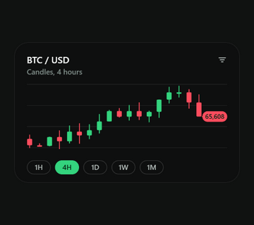](charts/candlestick/) <br>BTC/USD Candlestick <br>`Quix` | [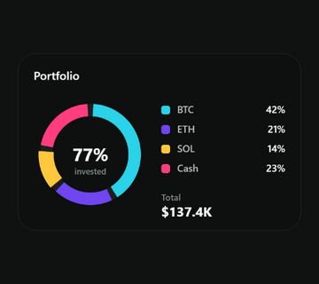](charts/portfolio-donut/) <br>Portfolio Donut <br>`Quix` | [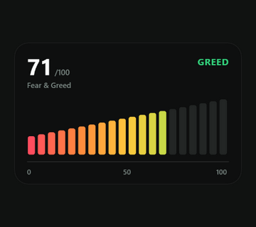](charts/fear-greed/) <br>Fear & Greed Index <br>`Quix` |
| [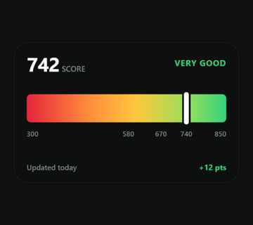](charts/credit-score/) <br>Credit Score <br>`Quix` | [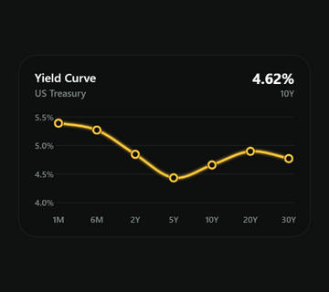](charts/yield-curve/) <br>Yield Curve <br>`Quix` | [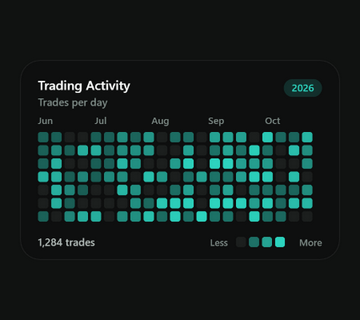](charts/activity-heatmap/) <br>Activity Heatmap <br>`Quix` |
| [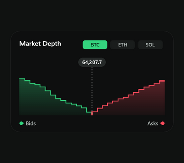](charts/market-depth/) <br>Market Depth <br>`Quix` | [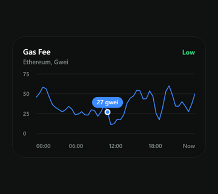](charts/gas-tracker/) <br>Gas Tracker <br>`Quix` | [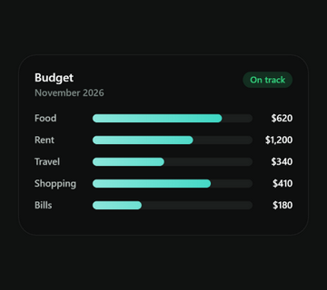](charts/budget-bars/) <br>Budget Bars <br>`Quix` |
| [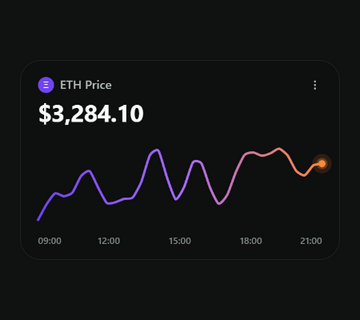](charts/gradient-line/) <br>Gradient Line <br>`Quix` | [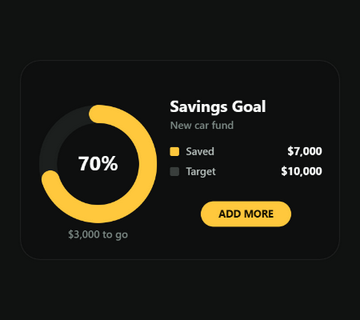](charts/savings-ring/) <br>Savings Ring <br>`Quix` | [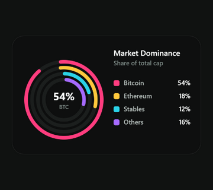](charts/dominance-rings/) <br>Market Dominance Rings <br>`Quix` |
| [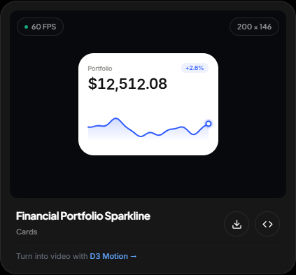](charts/stock-portfolio/) <br>Financial Portfolio Sparkline <br>`d3motion` |

## Indicators & Gauges — `indicators`

Quix percent gauges and progress bars (a single <lp-loader> element) next to d3motion status indicators.

|   |   |   |
| --- | --- | --- |
| [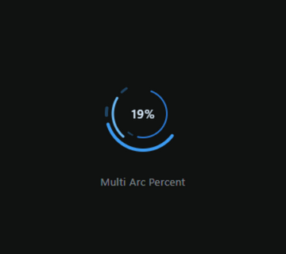](indicators/multi-arc-percent/) <br>Multi Arc Percent <br>`Quix` | [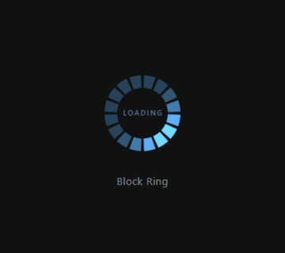](indicators/block-ring/) <br>Block Ring <br>`Quix` | [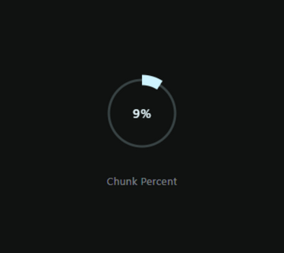](indicators/chunk-percent/) <br>Chunk Percent <br>`Quix` |
| [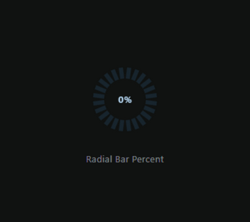](indicators/radial-bar-percent/) <br>Radial Bar Percent <br>`Quix` | [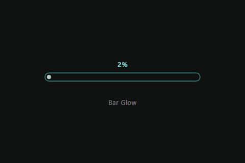](indicators/bar-glow/) <br>Bar Glow <br>`Quix` | [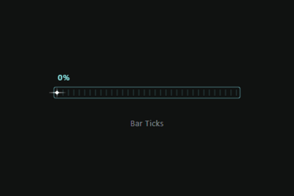](indicators/bar-ticks/) <br>Bar Ticks <br>`Quix` |
| [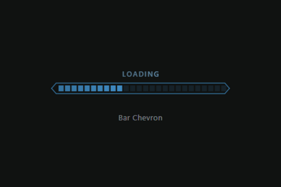](indicators/bar-chevron/) <br>Bar Chevron <br>`Quix` | [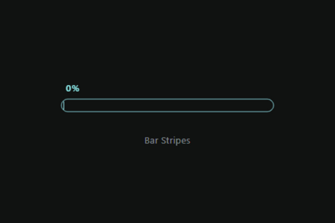](indicators/bar-stripes/) <br>Bar Stripes <br>`Quix` | [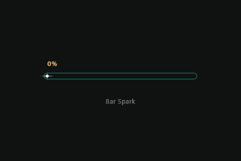](indicators/bar-spark/) <br>Bar Spark <br>`Quix` |
| [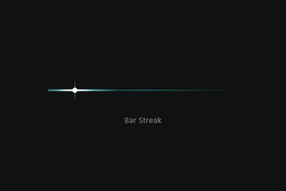](indicators/bar-streak/) <br>Bar Streak <br>`Quix` | [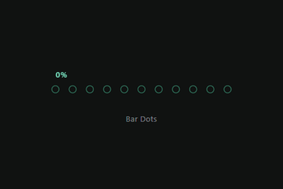](indicators/bar-dots/) <br>Bar Dots <br>`Quix` | [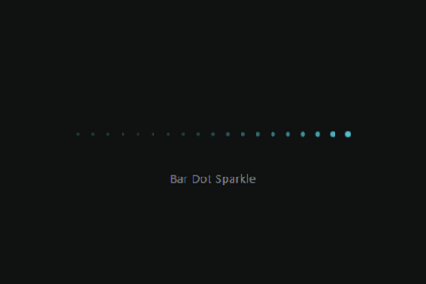](indicators/bar-dot-sparkle/) <br>Bar Dot Sparkle <br>`Quix` |
| [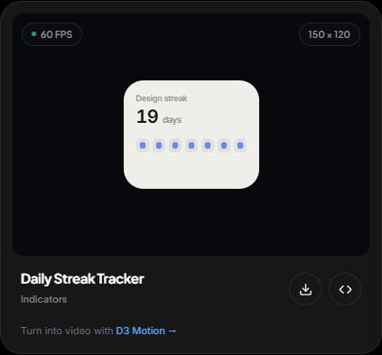](indicators/streak-tracker/) <br>Daily Streak Tracker <br>`d3motion` | [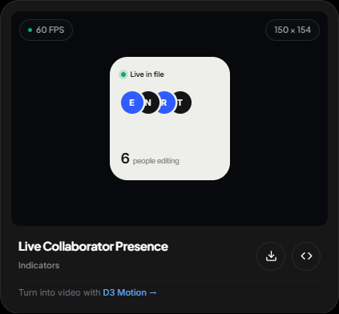](indicators/collaborator-presence/) <br>Live Collaborator Presence <br>`d3motion` | [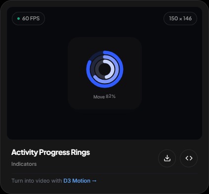](indicators/activity-rings/) <br>Activity Progress Rings <br>`d3motion` |
| [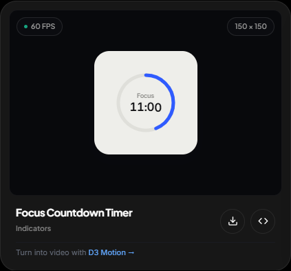](indicators/countdown-timer/) <br>Focus Countdown Timer <br>`d3motion` | [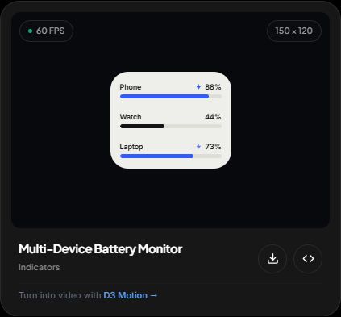](indicators/battery-monitor/) <br>Multi-Device Battery Monitor <br>`d3motion` |

## Toggles & Switches — `toggles`

The VibeHub day/night switch (React source + build-free demo) and d3motion switches.

|   |   |   |
| --- | --- | --- |
| [](toggles/day-night-switch/) <br>Day & Night Theme Switch (VibeHub) <br>`VibeHub` | [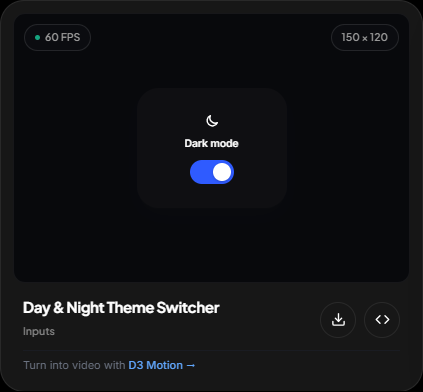](toggles/theme-toggle/) <br>Day & Night Theme Switcher (d3motion) <br>`d3motion` | [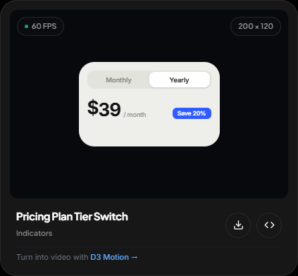](toggles/pricing-toggle/) <br>Pricing Plan Tier Switch <br>`d3motion` |

## Buttons — `buttons`

|   |   |   |
| --- | --- | --- |
| [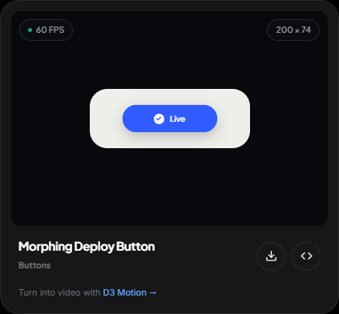](buttons/deploy-button/) <br>Morphing Deploy Button <br>`d3motion` | [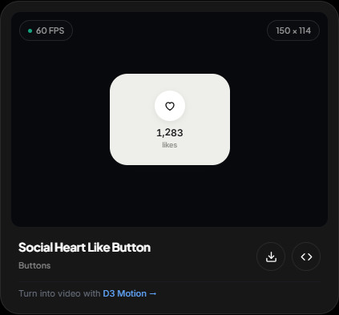](buttons/social-heart-like/) <br>Social Heart Like Button <br>`d3motion` |

## Cards — `cards`

|   |   |   |
| --- | --- | --- |
| [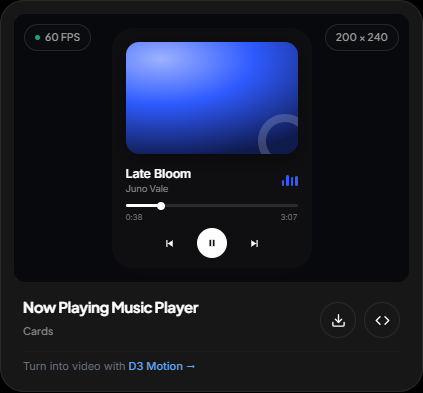](cards/music-player/) <br>Now Playing Music Player <br>`d3motion` | [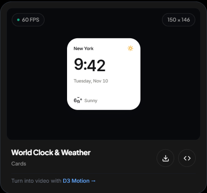](cards/weather-clock/) <br>World Clock & Weather <br>`d3motion` | [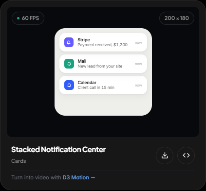](cards/notification-stack/) <br>Stacked Notification Center <br>`d3motion` |

## Inputs — `inputs`

|   |   |   |
| --- | --- | --- |
| [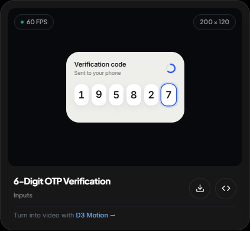](inputs/otp-verification/) <br>6-Digit OTP Verification <br>`d3motion` | [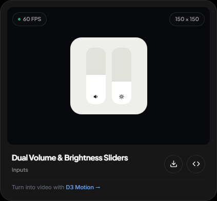](inputs/volume-brightness-sliders/) <br>Dual Volume & Brightness Sliders <br>`d3motion` | [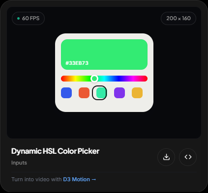](inputs/color-picker/) <br>Dynamic HSL Color Picker <br>`d3motion` |

## Navigation — `navigation`

|   |   |   |
| --- | --- | --- |
| [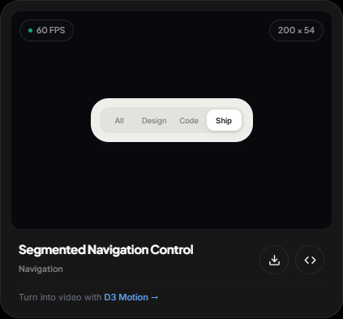](navigation/segmented-control/) <br>Segmented Navigation Control <br>`d3motion` | [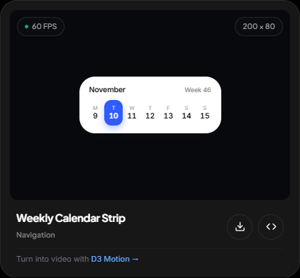](navigation/weekly-calendar/) <br>Weekly Calendar Strip <br>`d3motion` | [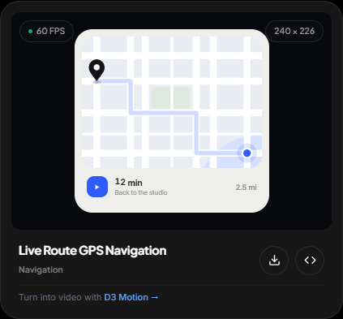](navigation/route-navigation/) <br>Live Route GPS Navigation <br>`d3motion` |
| [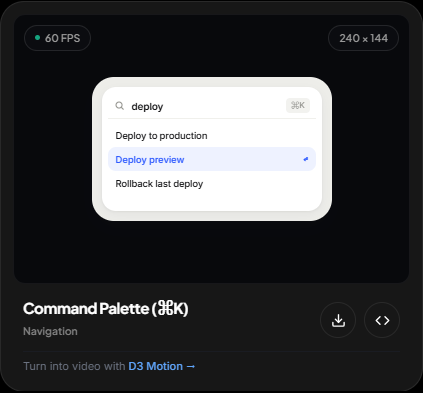](navigation/command-palette/) <br>Command Palette (⌘K) <br>`d3motion` |

## Interactions — `interactions`

|   |   |   |
| --- | --- | --- |
| [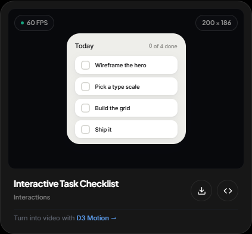](interactions/task-checklist/) <br>Interactive Task Checklist <br>`d3motion` | [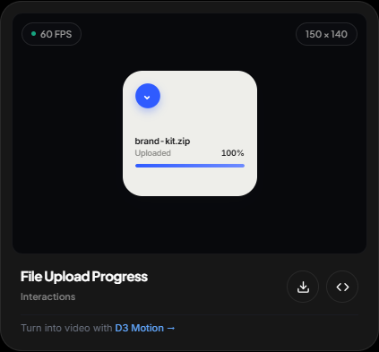](interactions/file-upload/) <br>File Upload Progress <br>`d3motion` | [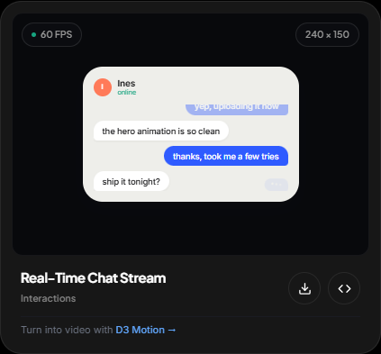](interactions/chat-stream/) <br>Real-Time Chat Stream <br>`d3motion` |
| [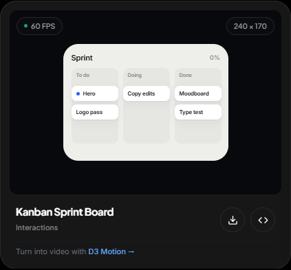](interactions/kanban-board/) <br>Kanban Sprint Board <br>`d3motion` |

## Product showcase — showcase

**Cake Couch** — an animated product showcase with three cycling themes, a hidden orbit the objects ride on, and a rotating color pentagon backdrop. Pure HTML/CSS/JS with hand-drawn SVG artwork, zero dependencies (~12KB gzipped). Full code in [showcase/cake-couch/](showcase/cake-couch/) — [item README](showcase/cake-couch/README.md) · [live demo](https://cake-couch-animation.vercel.app) · [source repo](https://github.com/HamzehGhoreyshi/cake-couch-animation)

| Card | Three-theme loop |
| --- | --- |
| [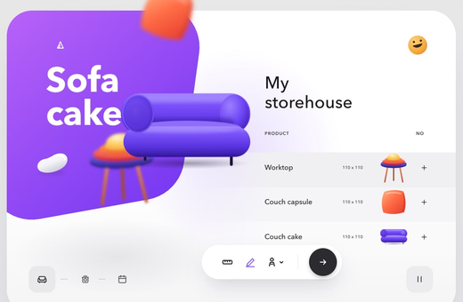](showcase/cake-couch/) | 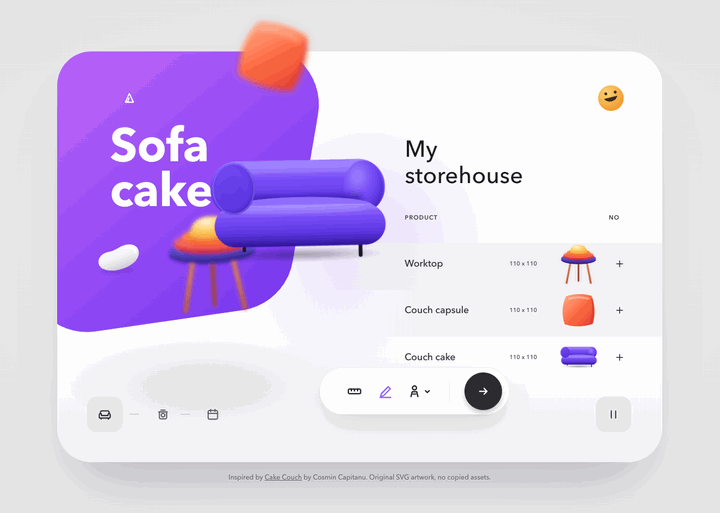 |

> `art.svg` is loaded with `fetch`; serve `showcase/cake-couch/` with `python -m http.server 4173` to run it.

---

## Sources & rights

| Source | Count | Rights |
| --- | --- | --- |
| [d3motion.pro/resources](https://d3motion.pro/resources) | 24 | No redistribution permission — personal reference only |
| [Quix Studio — Free Components](https://quixstudio.net/free/components) | 24 | Free for personal and commercial use (per the site) |
| VibeHub | 1 | My own code |
| [HamzehGhoreyshi/cake-couch-animation](https://github.com/HamzehGhoreyshi/cake-couch-animation) | 1 | Upstream repo has no license — personal reference only |

Per-item details (path, collection date, rights, dimensions) live in [SOURCES.md](SOURCES.md) (Persian).

> **Important:** most of this collection (d3motion and cake-couch) has no explicit redistribution permission, so **this repo must stay private** — it exists purely as a personal reference and source of inspiration.
