<div dir="rtl">

# گنجینهٔ UI — ui-vault

مجموعهٔ شخصی الهام‌های رابط کاربری: هر آیتم با اسکرین‌شات زنده ذخیره می‌شود تا با یک نگاه به تصاویر پیدا شود، و کد/دموی آن کنارش هست.

## ساختار

```text
ui-vault/
├─ vibehub/                  ← اجزای ساخته‌شده در اپ VibeHub
│  └─ theme-toggle/          ← سوییچ شب و روز (کد + CSS + دمو + اسکرین‌شات)
├─ d3motion/                 ← ۲۴ کامپوننت انیمیشنی رایگان از d3motion.pro
│  └─ <slug>/                ← card.png + component.html برای هر کامپوننت
└─ cake-couch/               ← نمایش محصول انیمیشنی تک‌فایلی (HTML + CSS + SVG)
   └─ shots/                 ← اسکرین‌شات، GIF سه تم و بنر
```

## VibeHub — سوییچ شب و روز

صحنهٔ کامل شبانه‌روزی داخل تایتل‌بار اپ: خورشید و ماه با انیمیشن خسوف، ابرهای سه‌لایه، ستاره‌های چشمک‌زن و شهاب‌سنگ. جزئیات کامل در [vibehub/theme-toggle/README.md](vibehub/theme-toggle/README.md) — `demo.html` را در مرورگر باز کنید تا زنده ببینید.

| روز | شب |
| --- | --- |
|  |  |

## Cake Couch — نمایش محصول انیمیشنی

کارت ویترین محصول با سه تم چرخشی، مداری نامرئی که اشیا رویش می‌گردند و پنتاگون رنگیِ پس‌زمینه که با هر تم ۱۴۴ درجه می‌چرخد. HTML/CSS/JS خالص با تصویرسازی SVG دست‌ساز، بدون وابستگی و بدون build (حدود ۱۲KB gzip). کد کامل در [cake-couch/](cake-couch/) است — [README آیتم](cake-couch/README.md) · [دموی زنده](https://cake-couch-animation.vercel.app) · [مخزن منبع](https://github.com/HamzehGhoreyshi/cake-couch-animation)

| کارت | انیمیشن |
| --- | --- |
| [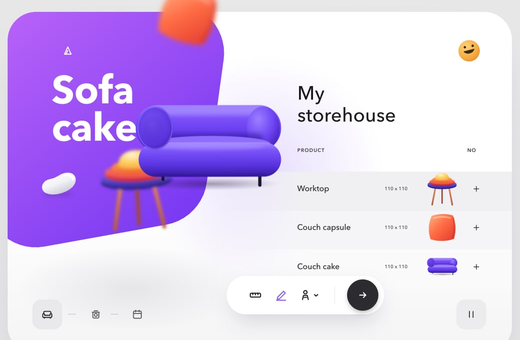](cake-couch/) | 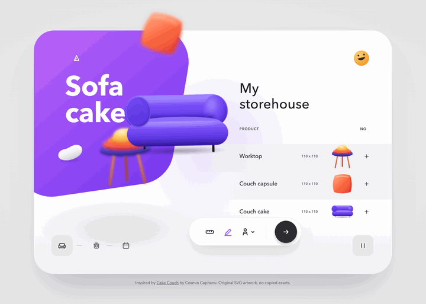 |

برای اجرا، `art.svg` با `fetch` خوانده می‌شود؛ داخل `cake-couch/` یک `python -m http.server 4173` بالا بیاورید و `http://localhost:4173` را باز کنید.

## d3motion.pro — اجزای رایگان انیمیشنی

۲۴ کامپوننت HTML مستقل (بدون وابستگی، ۶۰FPS) که از [صفحهٔ Resources](https://d3motion.pro/resources) دانلود شده‌اند. نمایهٔ تصویری کامل با دسته‌بندی و ابعاد: [d3motion/README.md](d3motion/README.md)

| | | | |
| --- | --- | --- | --- |
| [](d3motion/music-player/) | [](d3motion/segmented-control/) | [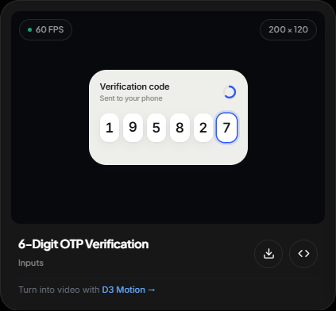](d3motion/otp-verification/) | [](d3motion/weekly-calendar/) |
| [](d3motion/task-checklist/) | [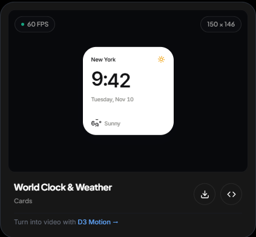](d3motion/weather-clock/) | [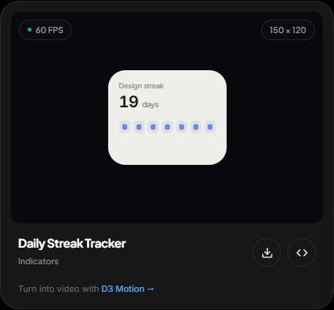](d3motion/streak-tracker/) | [](d3motion/file-upload/) |
| [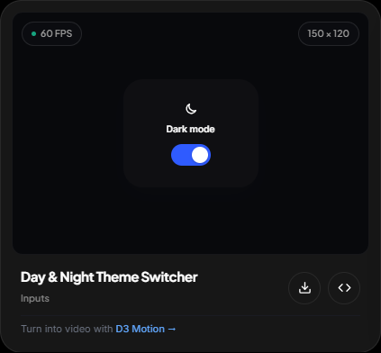](d3motion/theme-toggle/) | [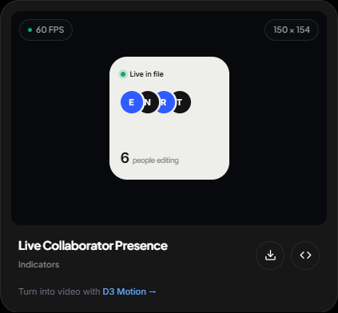](d3motion/collaborator-presence/) | [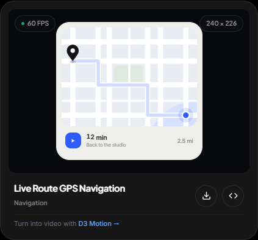](d3motion/route-navigation/) | [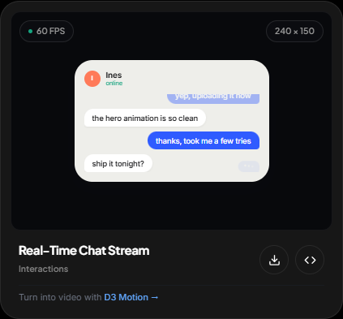](d3motion/chat-stream/) |
| [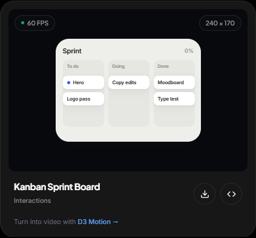](d3motion/kanban-board/) | [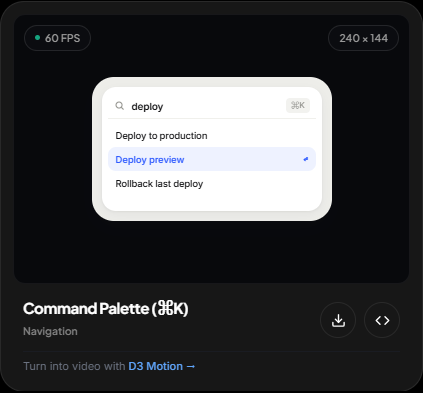](d3motion/command-palette/) | [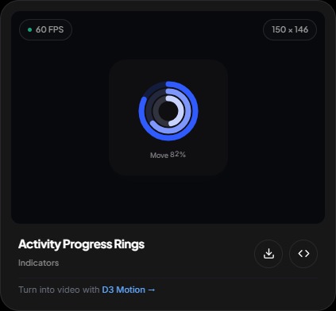](d3motion/activity-rings/) | [](d3motion/volume-brightness-sliders/) |
| [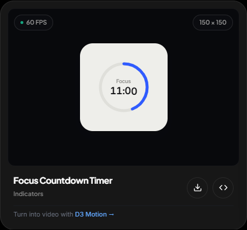](d3motion/countdown-timer/) | [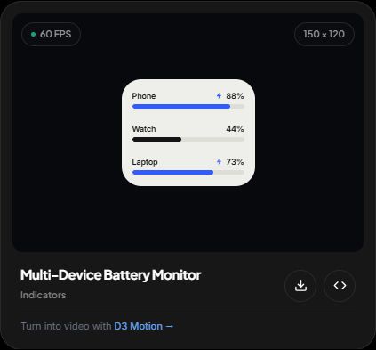](d3motion/battery-monitor/) | [](d3motion/social-heart-like/) | [](d3motion/stock-portfolio/) |
| [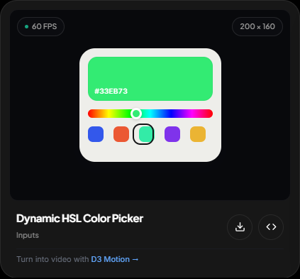](d3motion/color-picker/) | [](d3motion/notification-stack/) | [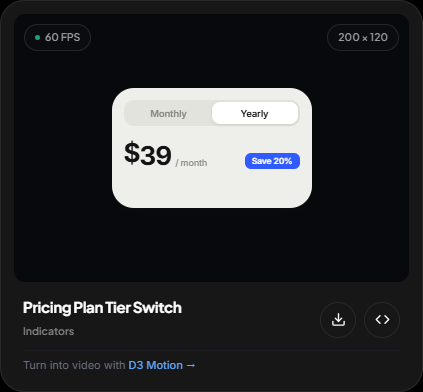](d3motion/pricing-toggle/) | [](d3motion/deploy-button/) |

## چطور مرور کنم؟

- روی گیت‌هاب: همین README تصاویر را رندر می‌کند؛ روی هر تصویر کلیک کنید تا پوشهٔ آیتم باز شود.
- محلی: هر `component.html` و `demo.html` را مستقیم در مرورگر باز کنید — انیمیشن زندهٔ واقعی را می‌بینید.

> **نکتهٔ حقوقی:** فایل‌های `d3motion/` عیناً از سایت منبع دانلود شده‌اند و متعلق به سازندهٔ d3motion.pro هستند؛ این مجموعه فقط برای مرجع شخصی است و این ریپو باید خصوصی بماند.
>
> `cake-couch/` از مخزن عمومی [HamzehGhoreyshi/cake-couch-animation](https://github.com/HamzehGhoreyshi/cake-couch-animation) کپی شده و تصویرسازی‌هایش کار اورجینال همان نویسنده است (الهام از شات Cake Couch اثر Cosmin Capitanu، بدون کپی asset). آن مخزن فایل لایسنس ندارد، پس این کپی هم فقط مرجع شخصی است.
</div>
