<div dir="rtl">

# گنجینهٔ UI — ui-vault

مجموعهٔ شخصی الهام‌های رابط کاربری: **50 آیتم** که بر اساس *کارکرد* دسته‌بندی شده‌اند تا هر چیزی را که لازم داری، کنار همکاران خودش پیدا کنی. هر آیتم با اسکرین‌شات زنده ذخیره می‌شود و کد/دمویش کنارش هست.

```text
ui-vault/
├─ index.html            ← گالری زندهٔ همهٔ آیتم‌ها (بخش‌بندی کارکردی + جستجو)
├─ SOURCES.md            ← منبع هر آیتم، تاریخ جمع‌آوری و وضعیت حقوق
├─ charts/               ← نمودارها (13) — ۱۲ کارت مالی Quix + اسپارک‌لاین d3motion
├─ indicators/           ← نشانگرها و گیج‌ها (17) — ۱۲ گیج Quix + ۵ نشانگر d3motion
├─ toggles/              ← سوییچ‌ها (3)
├─ buttons/              ← دکمه‌ها (2)
├─ cards/                ← کارت‌ها (3)
├─ inputs/               ← ورودی‌ها (3)
├─ navigation/           ← ناوبری (4)
├─ interactions/         ← تعاملات (4)
└─ showcase/             ← ویترین محصول انیمیشنی (۱)
```

## چطور مرور کنم؟

- **گالری زنده:** `index.html` را باز کنید (ترجیحاً با سرور محلی — `python -m http.server 4173` — تا همهٔ پیش‌نمایش‌ها زنده بارگذاری شوند). همهٔ آیتم‌ها انیمیشن‌دار، بخش‌بندی کارکردی و با جستجو.
- **روی گیت‌هاب:** همین README تصاویر را رندر می‌کند؛ کلیک روی هر تصویر، پوشهٔ آیتم را باز می‌کند.
- **محلی:** هر `component.html` / `demo.html` / `index.html` داخل پوشهٔ آیتم را مستقیم در مرورگر باز کنید.

---

## نمودارها — charts

کارت‌های مالی انیمیشنی از [Quix Studio](https://quixstudio.net/free/components#charts) به‌همراه اسپارک‌لاین d3motion؛ همه زنده در مرورگر اجرا می‌شوند.
|   |   |   |
| --- | --- | --- |
| [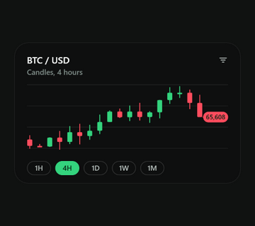](charts/candlestick/) <br>کندل‌استیک BTC/USD <br>`Quix` | [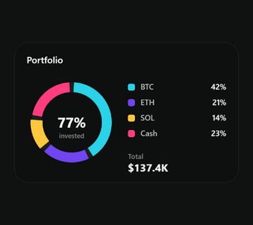](charts/portfolio-donut/) <br>دونات سبد سرمایه <br>`Quix` | [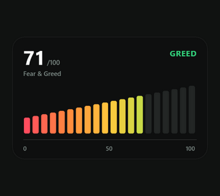](charts/fear-greed/) <br>شاخص ترس و طمع <br>`Quix` |
| [](charts/credit-score/) <br>امتیاز اعتباری <br>`Quix` | [](charts/yield-curve/) <br>منحنی بازده <br>`Quix` | [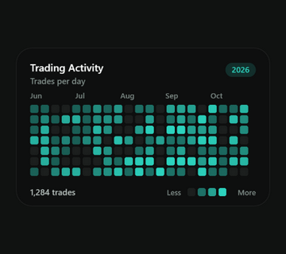](charts/activity-heatmap/) <br>هیت‌مپ فعالیت <br>`Quix` |
| [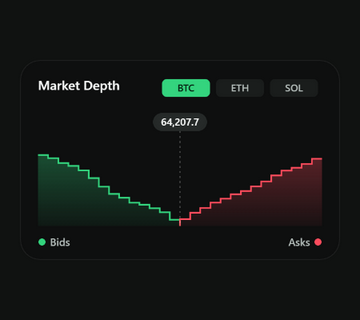](charts/market-depth/) <br>عمق بازار <br>`Quix` | [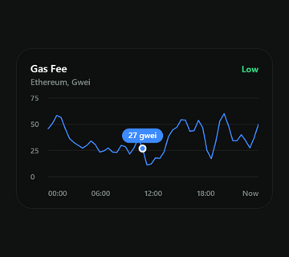](charts/gas-tracker/) <br>ردیاب کارمزد گس <br>`Quix` | [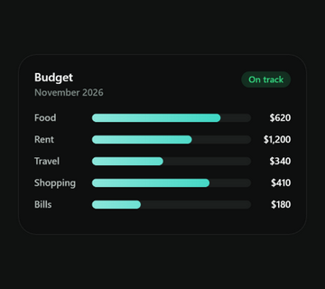](charts/budget-bars/) <br>میله‌های بودجه <br>`Quix` |
| [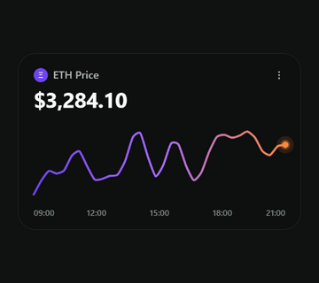](charts/gradient-line/) <br>خط گرادیانی <br>`Quix` | [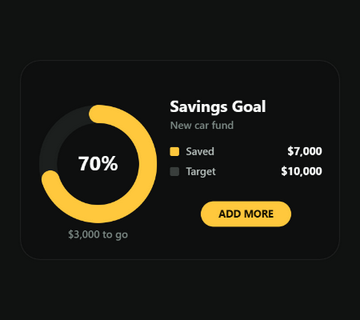](charts/savings-ring/) <br>حلقهٔ پس‌انداز <br>`Quix` | [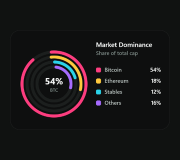](charts/dominance-rings/) <br>حلقه‌های سلطهٔ بازار <br>`Quix` |
| [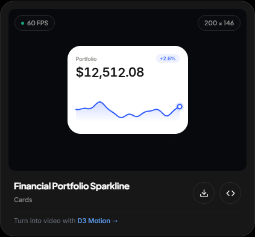](charts/stock-portfolio/) <br>اسپارک‌لاین پرتفوی مالی <br>`d3motion` |


## نشانگرها و گیج‌ها — indicators

گیج‌های درصدی و نوارهای پیشرفت Quix (عنصر `<lp-loader>` با اتریبیوت‌های type/color/speed/value) کنار نشانگرهای d3motion.
|   |   |   |
| --- | --- | --- |
| [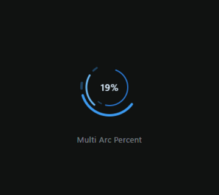](indicators/multi-arc-percent/) <br>گیج درصدی سه‌قوسی <br>`Quix` | [](indicators/block-ring/) <br>حلقهٔ بلوکی درصد <br>`Quix` | [](indicators/chunk-percent/) <br>گیج درصدی تکه‌ای <br>`Quix` |
| [](indicators/radial-bar-percent/) <br>نوار پیشرفت شعاعی <br>`Quix` | [](indicators/bar-glow/) <br>نوار پیشرفت درخشان <br>`Quix` | [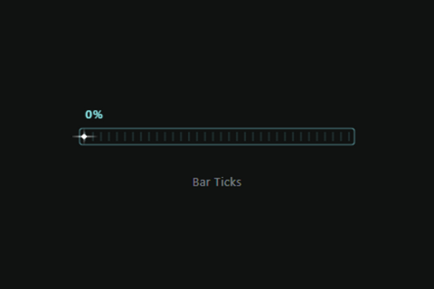](indicators/bar-ticks/) <br>نوار پیشرفت تیک‌دار <br>`Quix` |
| [](indicators/bar-chevron/) <br>نوار پیشرفت شورون <br>`Quix` | [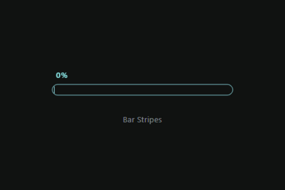](indicators/bar-stripes/) <br>نوار پیشرفت راه‌راه <br>`Quix` | [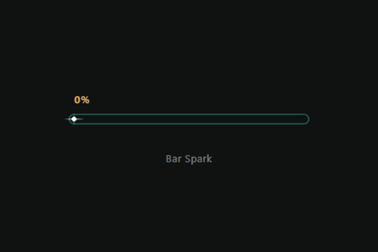](indicators/bar-spark/) <br>نوار پیشرفت جرقه‌ای <br>`Quix` |
| [](indicators/bar-streak/) <br>نوار پیشرفت رگهٔ نور <br>`Quix` | [](indicators/bar-dots/) <br>نوار پیشرفت نقطه‌ای <br>`Quix` | [](indicators/bar-dot-sparkle/) <br>نوار نقطه‌ای درخشان <br>`Quix` |
| [](indicators/streak-tracker/) <br>ردیاب استریک روزانه <br>`d3motion` | [](indicators/collaborator-presence/) <br>حضور زندهٔ همکاران <br>`d3motion` | [](indicators/activity-rings/) <br>حلقه‌های پیشرفت <br>`d3motion` |
| [](indicators/countdown-timer/) <br>تایمر تمرکز (پومودورو) <br>`d3motion` | [](indicators/battery-monitor/) <br>مانیتور باتری چنددستگاهی <br>`d3motion` |


## سوییچ‌ها — toggles

سوییچ شب و روز VibeHub (کد React + دموی زنده) و سوییچ‌های d3motion.
|   |   |   |
| --- | --- | --- |
| [](toggles/day-night-switch/) <br>سوییچ شب و روز (VibeHub) <br>`VibeHub` | [](toggles/theme-toggle/) <br>سوییچ شب و روز d3motion <br>`d3motion` | [](toggles/pricing-toggle/) <br>سوییچ پلن قیمت <br>`d3motion` |


## دکمه‌ها — buttons


|   |   |   |
| --- | --- | --- |
| [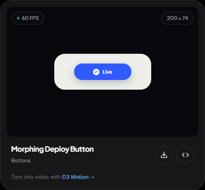](buttons/deploy-button/) <br>دکمهٔ دیپلوی مورف‌شونده <br>`d3motion` | [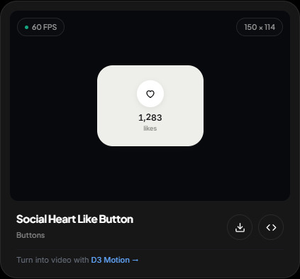](buttons/social-heart-like/) <br>دکمهٔ لایک قلب <br>`d3motion` |


## کارت‌ها — cards


|   |   |   |
| --- | --- | --- |
| [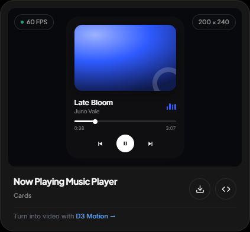](cards/music-player/) <br>پلیر موسیقی Now Playing <br>`d3motion` | [](cards/weather-clock/) <br>ساعت جهانی و آب‌وهوا <br>`d3motion` | [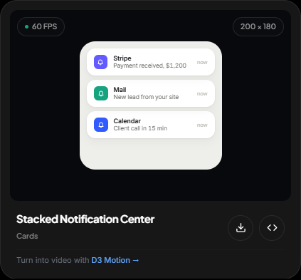](cards/notification-stack/) <br>مرکز اعلان انباشته <br>`d3motion` |


## ورودی‌ها — inputs


|   |   |   |
| --- | --- | --- |
| [](inputs/otp-verification/) <br>تأیید کد ۶ رقمی OTP <br>`d3motion` | [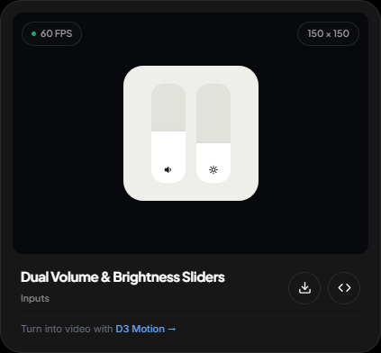](inputs/volume-brightness-sliders/) <br>اسلایدر صدا و روشنایی <br>`d3motion` | [](inputs/color-picker/) <br>انتخابگر رنگ HSL <br>`d3motion` |


## ناوبری — navigation


|   |   |   |
| --- | --- | --- |
| [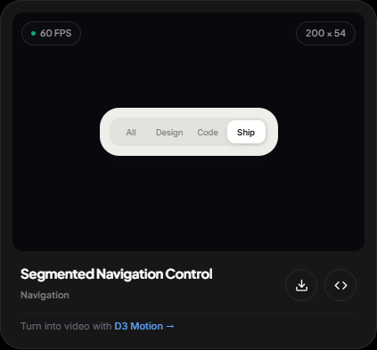](navigation/segmented-control/) <br>کنترل ناوبری سگمنتی <br>`d3motion` | [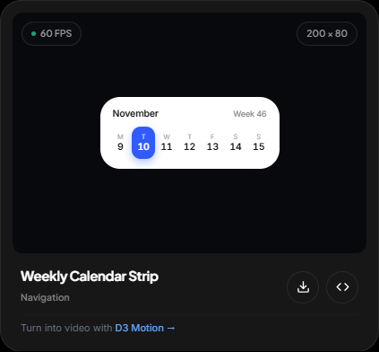](navigation/weekly-calendar/) <br>نوار تقویم هفتگی <br>`d3motion` | [](navigation/route-navigation/) <br>ناوبری زندهٔ GPS <br>`d3motion` |
| [](navigation/command-palette/) <br>کامند پلت ⌘K <br>`d3motion` |


## تعاملات — interactions


|   |   |   |
| --- | --- | --- |
| [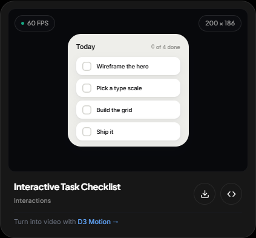](interactions/task-checklist/) <br>چک‌لیست تعاملی <br>`d3motion` | [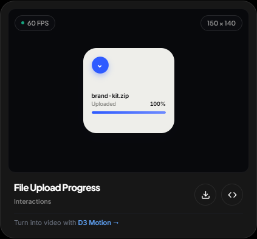](interactions/file-upload/) <br>پیشرفت آپلود فایل <br>`d3motion` | [](interactions/chat-stream/) <br>جریان چت زنده <br>`d3motion` |
| [](interactions/kanban-board/) <br>برد کانبان اسپرینت <br>`d3motion` |


## ویترین محصول — showcase

**Cake Couch** — نمایش محصول انیمیشنی با سه تم چرخشی، مداری نامرئی و پنتاگون چرخان پس‌زمینه. HTML/CSS/JS خالص با SVG دست‌ساز، بدون وابستگی (~۱۲KB gzip). کد کامل در [showcase/cake-couch/](showcase/cake-couch/) — [README آیتم](showcase/cake-couch/README.md) · [دموی زنده](https://cake-couch-animation.vercel.app) · [مخزن منبع](https://github.com/HamzehGhoreyshi/cake-couch-animation)

| کارت | انیمیشن سه تم |
| --- | --- |
| [](showcase/cake-couch/) |  |

> `art.svg` با `fetch` خوانده می‌شود؛ برای اجرا داخل `showcase/cake-couch/` یک `python -m http.server 4173` بالا بیاورید.

---

> **نکتهٔ حقوقی:** فایل‌های `d3motion` عیناً از [d3motion.pro/resources](https://d3motion.pro/resources) دانلود شده‌اند و متعلق به سازندهٔ آن سایت‌اند؛ اجازهٔ بازنشر صریحی داده نشده، پس این ریپو باید خصوصی بماند. کامپوننت‌های `Quix` از بخش رایگان [quixstudio.net](https://quixstudio.net/free/components) کپی شده‌اند که طبق اعلام سایت برای «استفادهٔ شخصی و تجاری» آزادند. `cake-couch` از مخزن عمومی [HamzehGhoreyshi/cake-couch-animation](https://github.com/HamzehGhoreyshi/cake-couch-animation) کپی شده و فایل لایسنس ندارد — همه جزئیات در [SOURCES.md](SOURCES.md).
</div>
