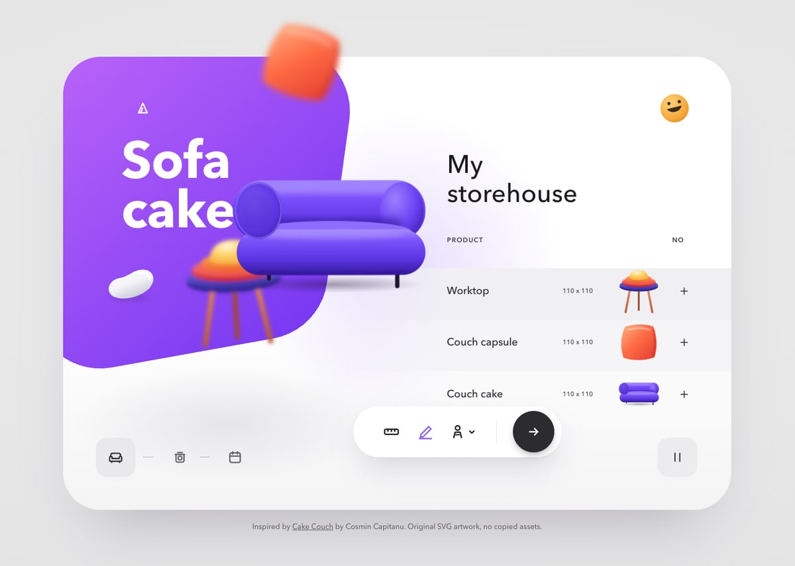
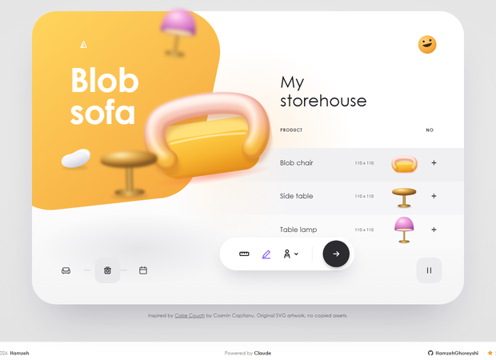

<div dir="rtl">

# Cake Couch — نمایش محصول انیمیشنی

کارتِ ویترینِ محصول در قالب یک صفحهٔ HTML تنها: سه تم پشت‌سرهم می‌چرخند، همهٔ اشیا روی یک دایرهٔ نامرئی می‌گردند و پنتاگونِ گردِ پس‌زمینه با هر تم ۱۴۴ درجه می‌چرخد و رنگ عوض می‌کند. بدون فریم‌ورک، بدون فونت، بدون تصویر، بدون مرحلهٔ build — حدود ۱۲ کیلوبایت gzip.

- **دموی زنده:** <https://cake-couch-animation.vercel.app>
- **منبع:** [HamzehGhoreyshi/cake-couch-animation](https://github.com/HamzehGhoreyshi/cake-couch-animation)
- **الهام:** [Cake Couch](https://dribbble.com/shots/16460483-Cake-Couch) اثر Cosmin Capitanu — همهٔ تصویرسازی‌ها SVG اورجینال است و هیچ asset ای کپی نشده.

## چطور حرکت می‌کند

- سه تم (Sofa cake، Blob sofa، Herbs pods) در حلقه جای هم را می‌گیرند.
- هر شیء روی یک دایرهٔ نامرئی و در جهت عقربه‌های ساعت حرکت می‌کند؛ دستهٔ قبلی از پایین‌چپ بیرون می‌رود و دستهٔ جدید از بالا می‌آید. اشیای تارِ پیش‌زمینه مسیر بیشتری طی می‌کنند تا عمق حس شود.
- پس‌زمینهٔ رنگی یک پنتاگونِ گرد است که با هر تم ۱۴۴ درجه حول همان مرکز می‌چرخد؛ کارت آن را می‌بُرد، پس شکلِ دیده‌شده مدام عوض می‌شود.
- تیتر و ردیف‌های محصول مثل یک نوار به چپ بیرون می‌روند و نوار جدید پشت سرشان می‌آید.
- با هاور، فوکوس، تبِ پنهان و دکمهٔ توقف متوقف می‌شود و `prefers-reduced-motion` را رعایت می‌کند.

## تصاویر

| تم Sofa cake (اسکرین‌شات رسمی) | تم Blob sofa (اجرای واقعی همین کپی) |
| --- | --- |
|  |  |

انیمیشن کامل سه تم: [shots/loop.gif](shots/loop.gif) (۷۲۰×۵۱۳، ۱۴۱ فریم)

## فایل‌ها

| فایل | محتوا |
| --- | --- |
| `index.html` | فقط مارک‌آپ: کارت، لیست، کنترل‌ها، فوتر |
| `art.svg` | تمام تصویرسازی: گرادیان‌ها، فیلترهای blur و symbol ها (اول preload و بعد توسط `app.js` درون‌خطی می‌شود) |
| `style.css` | چیدمان، رنگ تم‌ها و همهٔ حرکت‌ها (transition و keyframe) |
| `app.js` | دادهٔ تم‌ها؛ ساخت hero و لیست، اجرای مدار، چرخش پنتاگون و پخش خودکار |
| `card.png` | برشِ کارت از اسکرین‌شات، برای جدول تصویری README اصلی |
| `shots/` | `screenshot.jpg` · `live-blob-sofa.png` · `loop.gif` · `banner.jpg` |
| `SOURCE-README.md` | README اصلی مخزن سازنده، دست‌نخورده |

## اجرای محلی

`art.svg` با `fetch` خوانده می‌شود، پس باز کردن مستقیم `index.html` با `file://` کار نمی‌کند؛ یک سرور کوچک لازم است:

```bash
cd cake-couch
python -m http.server 4173
```

سپس <http://localhost:4173> را باز کنید.

> **منبع و حقوق:** فایل‌های `index.html`، `art.svg`، `style.css` و `app.js` عیناً از مخزن عمومی [HamzehGhoreyshi/cake-couch-animation](https://github.com/HamzehGhoreyshi/cake-couch-animation) (۱۷ نوامبر ۲۰۲۶) کپی شده‌اند. تصویرسازی‌ها کار اورجینال نویسنده‌اند و از هیچ asset ای کپی نشده‌اند؛ خودِ شاتِ Dribbble فقط الهام بوده است. مخزن بالادست فایل لایسنس ندارد، پس این کپی تنها برای مرجع شخصی و الهام‌گیری نگه داشته می‌شود و این ریپو باید خصوصی بماند. فقط مسیر تصاویر جابه‌جا شده است: `docs/cake-couch.gif` → `shots/loop.gif` و `docs/screenshot.jpg` → `shots/screenshot.jpg`.
</div>
