

# اجزای رایگان D3 Motion

۲۴ کامپوننت انیمیشنی از [d3motion.pro/resources](https://d3motion.pro/resources) — همه به‌صورت فایل HTML مستقل با «صفر وابستگی» از خود صفحه قابل دانلود بودند. هر پوشه شامل:

- `card.png` — اسکرین‌شات زندهٔ کارت کامپوننت (همان‌طور که در صفحه دیده می‌شود)
- `component.html` — فایل اصلی دانلودشده؛ مستقیم در مرورگر باز کنید تا انیمیشن زنده را ببینید

> **منبع و حقوق:** فایل‌ها عیناً از سایت d3motion.pro دانلود شده‌اند (۱۶ نوامبر ۲۰۲۶) و متعلق به سازندهٔ آن سایت‌اند. این مجموعه فقط برای مرجع شخصی و الهام‌گیری است؛ صفحهٔ License سایت فقط دربارهٔ خود اپ D3 Motion است و اجازهٔ بازنشر صریحی برای این فایل‌ها نمی‌دهد — این ریپو باید خصوصی بماند.

## نمایهٔ تصویری

| | | | |
| --- | --- | --- | --- |
| [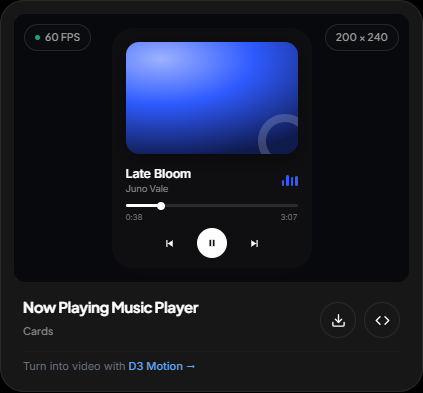](music-player/)  پلیر موسیقی Now Playing  `Cards` | [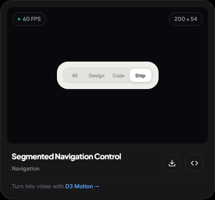](segmented-control/)  کنترل ناوبری سگمنتی  `Navigation` | [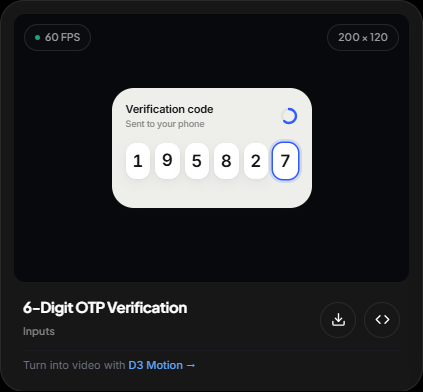](otp-verification/)  تأیید کد ۶ رقمی OTP  `Inputs` | [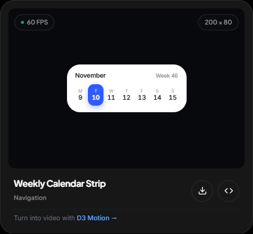](weekly-calendar/)  نوار تقویم هفتگی  `Navigation` |
| [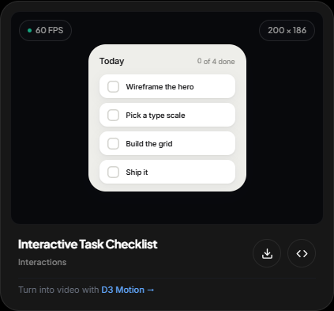](task-checklist/)  چک‌لیست تعاملی  `Interactions` | [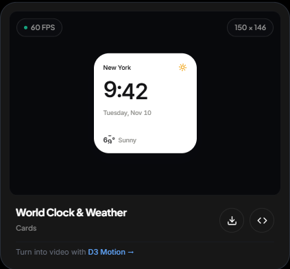](weather-clock/)  ساعت جهانی و آب‌وهوا  `Cards` | [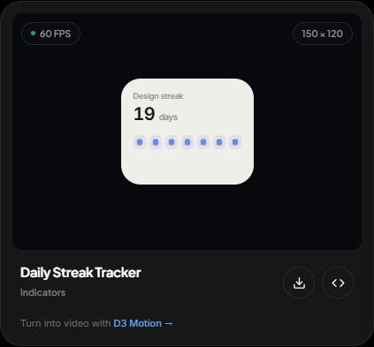](streak-tracker/)  ردیاب استریک روزانه  `Indicators` | [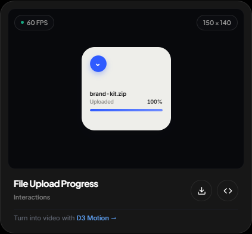](file-upload/)  پیشرفت آپلود فایل  `Interactions` |
| [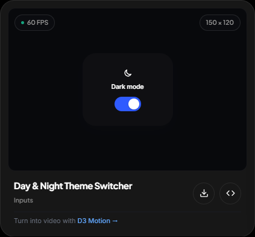](theme-toggle/)  سوییچ شب و روز  `Inputs` | [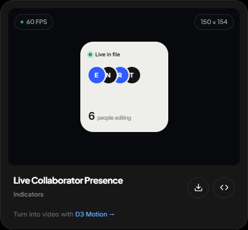](collaborator-presence/)  حضور زندهٔ همکاران  `Indicators` | [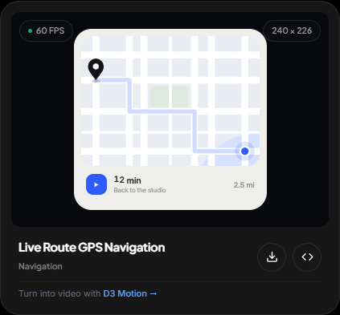](route-navigation/)  ناوبری زندهٔ GPS  `Navigation` | [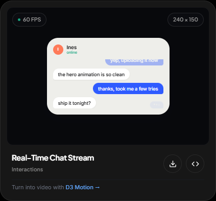](chat-stream/)  جریان چت زنده  `Interactions` |
| [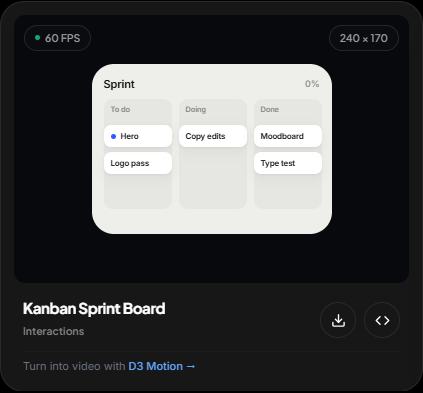](kanban-board/)  برد کانبان اسپرینت  `Interactions` | [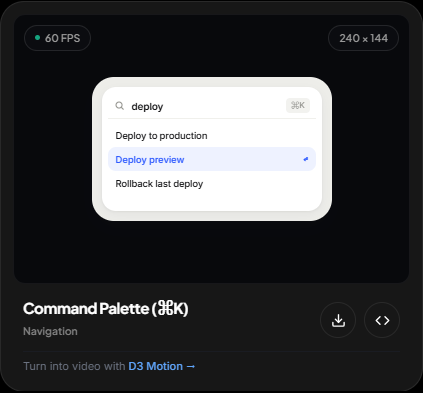](command-palette/)  کامند پلت ⌘K  `Navigation` | [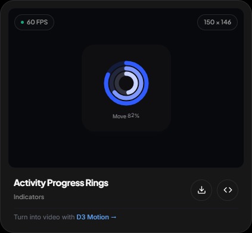](activity-rings/)  حلقه‌های پیشرفت  `Indicators` | [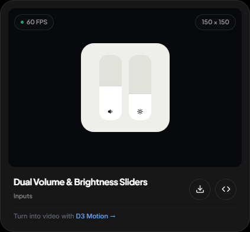](volume-brightness-sliders/)  اسلایدر صدا و روشنایی  `Inputs` |
| [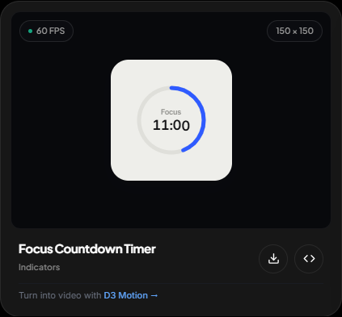](countdown-timer/)  تایمر تمرکز (پومودورو)  `Indicators` | [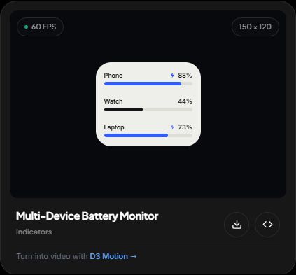](battery-monitor/)  مانیتور باتری چنددستگاهی  `Indicators` | [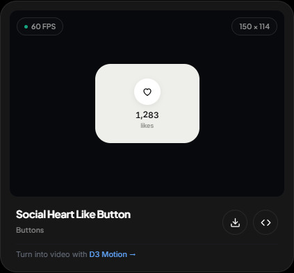](social-heart-like/)  دکمهٔ لایک قلب  `Buttons` | [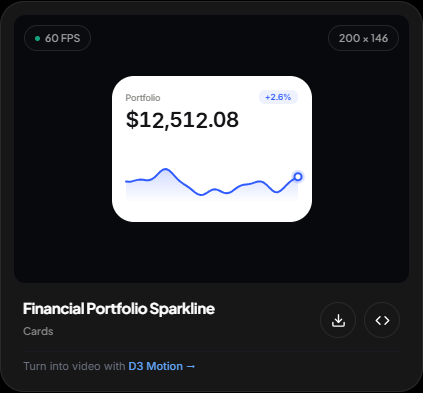](stock-portfolio/)  نمودار پرتفوی مالی  `Cards` |
| [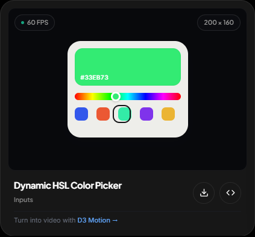](color-picker/)  انتخابگر رنگ HSL  `Inputs` | [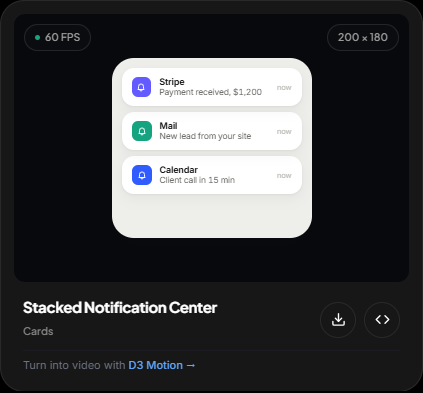](notification-stack/)  مرکز اعلان انباشته  `Cards` | [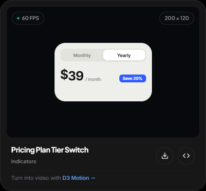](pricing-toggle/)  سوییچ پلن قیمت  `Indicators` | [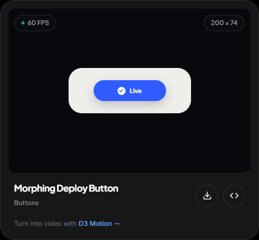](deploy-button/)  دکمهٔ دیپلوی مورف‌شونده  `Buttons` |

## ابعاد و اسلاگ‌ها

| اسلاگ | نام | دسته | ابعاد (px) |
| --- | --- | --- | --- |
| `music-player` | Now Playing Music Player | Cards | 200×240 |
| `segmented-control` | Segmented Navigation Control | Navigation | 200×54 |
| `otp-verification` | 6-Digit OTP Verification | Inputs | 200×120 |
| `weekly-calendar` | Weekly Calendar Strip | Navigation | 200×80 |
| `task-checklist` | Interactive Task Checklist | Interactions | 200×186 |
| `weather-clock` | World Clock & Weather | Cards | 150×146 |
| `streak-tracker` | Daily Streak Tracker | Indicators | 150×120 |
| `file-upload` | File Upload Progress | Interactions | 150×140 |
| `theme-toggle` | Day & Night Theme Switcher | Inputs | 150×120 |
| `collaborator-presence` | Live Collaborator Presence | Indicators | 150×154 |
| `route-navigation` | Live Route GPS Navigation | Navigation | 240×226 |
| `chat-stream` | Real-Time Chat Stream | Interactions | 240×150 |
| `kanban-board` | Kanban Sprint Board | Interactions | 240×170 |
| `command-palette` | Command Palette (⌘K) | Navigation | 240×144 |
| `activity-rings` | Activity Progress Rings | Indicators | 150×146 |
| `volume-brightness-sliders` | Dual Volume & Brightness Sliders | Inputs | 150×150 |
| `countdown-timer` | Focus Countdown Timer | Indicators | 150×150 |
| `battery-monitor` | Multi-Device Battery Monitor | Indicators | 150×120 |
| `social-heart-like` | Social Heart Like Button | Buttons | 150×114 |
| `stock-portfolio` | Financial Portfolio Sparkline | Cards | 200×146 |
| `color-picker` | Dynamic HSL Color Picker | Inputs | 200×160 |
| `notification-stack` | Stacked Notification Center | Cards | 200×180 |
| `pricing-toggle` | Pricing Plan Tier Switch | Indicators | 200×120 |
| `deploy-button` | Morphing Deploy Button | Buttons | 200×74 |

