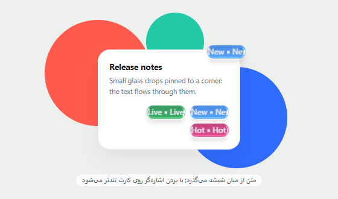

# نشان شیشه‌ای — Flow · GlassBadge

یک قطرهٔ کوچک شیشهٔ رنگ‌آلود با متنی که از میانش می‌گذرد: «New ▪ New ▪ …». متن زیر شیشه کشیده می‌شود، پس لبهٔ شیشه حروف را هنگام گذر خم می‌کند و هرچه پشت نشان است (مثلاً گوشهٔ کارت) نرم و مات از پشت شیشه دیده می‌شود. رنگ نشان همان پس‌زمینهٔ CSS خودش است و با بردن اشاره‌گر روی والدِ جای‌گذاری‌شده‌اش، جریان متن تندتر می‌شود. با `prefers-reduced-motion` متن می‌ایستد و وسط‌چین می‌شود.

## تصاویر

## فایل‌ها

- `demo.html` — پیش‌نمایش زندهٔ بدون build؛ کافی است در مرورگر بازش کنید.
- `card.png` — اسکرین‌شات همان پیش‌نمایش.
- `../src/liquid-glass/glass-badge.tsx` — کامپوننت اصلی (`GlassBadge`) که همین‌جا عیناً کپی شده است.
- `../src/liquid-glass/engine.ts` و `../src/liquid-glass/dom-snapshot.ts` — موتور <bdi>WebGL2</bdi> و پیمایش DOM که نشان مستقیماً از آنها استفاده می‌کند؛ برخلاف بقیهٔ کیت، نشان لایهٔ `GlassLayer` را صدا نمی‌زند و رندرکنندهٔ خودش را دارد (از `glass-layer.tsx` فقط CSS مشترک می‌آید).
- `../liquid-glass.js` — ران‌تایم وانیلا که `demo.html` بار می‌کند و از همان سورس‌های بالا به‌صورت مکانیکی ساخته شده است.
- `../glass.css` — اسکلت مشترک دموها: قاب صحنه، فونت و قطعه‌های پس‌زمینه‌ای که شیشه خمشان می‌کند.

`demo.html` یک **بازآفرینی بدون build** از همان رندرکننده است: کدی که شیشه را می‌کشد بازنویسی نشده و از سورس‌های بالایی برداشته شده (`engine.ts` و `dom-snapshot.ts` بدون تغییر، و بدنهٔ افکت نشان همان‌طور که هست)؛ فقط React کنار گذاشته شده و جایش فراخوانی‌های سادهٔ DOM آمده است. سه نشان روی یک سطح سفید نشسته‌اند — `New` آبی `#3291ff`، `Live` سبز `#16a34a` و `Hot` صورتی `#db2777` — و یک نشان چهارم به گوشهٔ همان سطح سنجاق شده است (`top: -8px` و `right: -10px`) تا گذر گوشهٔ کارت از پشت شیشه دیده شود. هر چهار نشان با `speed: 0.4` و `tint: 0.82` بسته می‌شوند و همان ۲۲×۶۴ پیکسلِ قرص‌شکل کامپوننت‌اند.

## منبع

- ریپو: <https://github.com/bilalgursen/liquid-glass>
- فایل در ریپو: `src/components/liquid-glass/glass-badge.tsx`
- لایسنس: MIT
- تاریخ جمع‌آوری: ۲۴ نوامبر ۲۰۲۶

## پراپ‌ها

| پراپ | نوع | پیش‌فرض | توضیح |
| --- | --- | --- | --- |
| `children` | `string` | — (الزامی) | متنی که از میان شیشه می‌گذرد؛ باید رشته باشد چون روی کانواس کشیده می‌شود |
| `dotColor` | `string` (رنگ CSS) | همان رنگ متن | رنگ جداکنندهٔ نقطه‌ای میان تکرارها |
| `speed` | `number` | `0.4` | دور در ثانیه در حالت سکون |
| `tint` | `number` | `0.82` | مقدار رنگی که روی پشت می‌نشیند (۰ تا ۱) |
| `className` | `string` | `''` | کلاس‌های خودتان؛ رنگ نشان را هم همین‌جا با `bg-*` عوض می‌کنید |

## نکات پیاده‌سازی

- متن نه روی شیشه، بلکه زیر آن کشیده می‌شود: بدنهٔ شیشه در همان پاس شکست، تصویر پشت و بعد رنگ و متن و نقطه‌ها را می‌نویسد، پس لبهٔ نشان حروف را هنگام گذر خم می‌کند. به همین دلیل `children` باید یک رشتهٔ ساده باشد، نه عنصر.
- بلورِ پشت با یک‌چهارم اندازه: پشت نشان یک بار با پیمایش DOM روی کانواسی به اندازهٔ یک‌چهارم عرض و ارتفاع کشیده می‌شود و بعد با کیفیت بالا به اندازهٔ اصلی بزرگ می‌شود — یک مات‌شدن ارزان. این تصویر فقط وقتی که کهنه شود یا حداکثر هر ۵۰۰ میلی‌ثانیه دوباره خوانده می‌شود، و بعد لایهٔ رنگ با `tint` روی آن می‌نشیند.
- تندشدن با اشاره‌گر: نرخ جریان روی `0.4` دور در ثانیه می‌ماند و با ورود اشاره‌گر روی والدِ جای‌گذاری‌شده با شتاب ۱٫۶ به سمت ۳٫۵ برابر می‌رود؛ با بیرون رفتن اشاره‌گر نرم به همان ۱ برمی‌گردد.
- اسنپ‌شات DOM: شیشه آنچه پشتش است را با پیمایش DOM دوباره نقاشی می‌کند، پس پشت نشان باید فقط رنگ تخت و عنصر واقعی باشد — گرادیان، ماسک CSS، فیلتر و شبه‌عنصر برایش دیده نمی‌شود.
- رنگ و آینه: پیش‌فرض `tint` روی ۰٫۸۲ است، یعنی بالاتر از آستانهٔ ۰٫۶، و نشانِ رنگ‌شده در این حالت چیزی از صفحهٔ اطرافش را بازنمی‌تاباند؛ با tint کمتر، لبهٔ نشان همسایه‌های رنگی را آینه می‌کند.
- بدون <bdi>WebGL2</bdi> یک مارکی CSS (`glass-marquee`) همان متن را می‌چرخاند و با `prefers-reduced-motion` متن ساکن و وسط‌چین می‌شود؛ این کامپوننت دست‌نویس است و به UI SDK نیاز ندارد.

