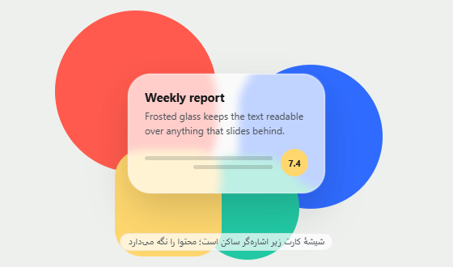

# کارت شیشه‌ای — Hold · GlassCard

کارتی از جنس شیشهٔ مایع که محتوای شما رویش می‌نشیند. شیشهٔ روی کارت هرچه پشتش باشد را مات و رنگ‌آلود می‌کند تا متن در هر شرایطی خوانا بماند، و لبهٔ کارت پشت را کمی به سمت مرکز می‌کشد. برخلاف دکمه‌ها، شیشهٔ کارت زیر اشاره‌گر ساکن است: کارت محتوا را نگه می‌دارد، دکمه نیست — نه متورم می‌شود، نه با فشار بزرگ می‌شود و نه با کشیدن اشاره‌گر دنبال آن می‌آید.

## تصاویر

## فایل‌ها

- `demo.html` — پیش‌نمایش زندهٔ بدون build؛ کافی است در مرورگر بازش کنید.
- `card.png` — اسکرین‌شات همان پیش‌نمایش.
- `../src/liquid-glass/glass-card.tsx` — کامپوننت اصلی (`GlassCard`) که همین‌جا عیناً کپی شده است.
- `../src/liquid-glass/glass-layer.tsx` — `GlassLayer`، همان لایه‌ای که شیشهٔ کارت و `optics` آن را می‌کشد.
- `../liquid-glass.js` — ران‌تایم وانیلا که `demo.html` بار می‌کند و از همان سورس بالا به‌صورت مکانیکی ساخته شده است.
- `../glass.css` — اسکلت مشترک دموها: قاب صحنه، فونت و قطعه‌های پس‌زمینه‌ای که شیشه خمشان می‌کند.

`demo.html` یک **بازآفرینی بدون build** از همان رندرکننده است: کدی که شیشه را می‌کشد بازنویسی نشده و از سورس بالایی برداشته شده (`engine.ts` و `dom-snapshot.ts` بدون تغییر، و بدنهٔ افکت `GlassLayer` همان‌طور که هست)؛ فقط React کنار گذاشته شده و جایش فراخوانی‌های سادهٔ DOM آمده است. کارت دمو ۲۴۴px عرض دارد، با گوشهٔ ۲۸px، پدینگ `18px 20px 20px` و همان ظاهر CSS نسخهٔ اصلی (`--glass-card-tint: 70%` و `--glass-card-blur: 5px`)؛ لایه با `material: 'clear'`، `tint: 0.7`، `blur: 5`، `swell: false` و همان `CARD_OPTICS` کامپوننت بسته می‌شود. `live` روشن نیست، چون در این صحنه چیزی پشت کارت حرکت نمی‌کند.

## منبع

- ریپو: <https://github.com/bilalgursen/liquid-glass>
- فایل در ریپو: `src/components/liquid-glass/glass-card.tsx`
- لایسنس: MIT
- تاریخ جمع‌آوری: ۲۴ نوامبر ۲۰۲۶

## پراپ‌ها

| پراپ | نوع | پیش‌فرض | توضیح |
| --- | --- | --- | --- |
| `children` | `ReactNode` | — | محتوای کارت |
| `material` | `'clear' \| 'tinted'` | `'clear'` | شیشهٔ شفاف که پشت را مات و خم می‌کند، یا شیشه به رنگ پس‌زمینهٔ خود کارت |
| `tint` | `number` | `0.7` | در شیشهٔ شفاف، مقدار رنگی که روی پشت می‌نشیند (۰ تا ۱): سفید روی صفحهٔ روشن، سیاه روی صفحهٔ تاریک |
| `blur` | `number` | `5` | در شیشهٔ شفاف، میزان مات‌شدن پشت، بر حسب پیکسل مثل `blur()` در CSS؛ `0` یعنی پشت تیز دیده شود |
| `live` | `boolean` | `false` | پشت را هر فریم دوباره نقاشی کن، برای محتوایی که پشت کارت حرکت می‌کند |
| `optics` | `GlassOptics` | — (روی `CARD_OPTICS` کامپوننت merge می‌شود) | ریزتنظیم شیشه: رنگ tint، خط لبه، ترکیب مات، خمش، نور و سایه |
| `className` | `string` | `''` | کلاس‌های خودتان؛ هر کلاس `rounded-*` گوشهٔ پیش‌فرض `rounded-[28px]` را عوض می‌کند |
| `style` | `CSSProperties` | — | استایل درون‌خطی؛ روی متغیرهای داخلی کارت (`--glass-card-tint` و `--glass-card-blur`) می‌نشیند |

بقیهٔ اتریبیوت‌های `
` (مثل `id` یا `data-*`) پاس داده می‌شوند؛ فقط `children` و `className` کنار گذاشته شده‌اند.

## نکات پیاده‌سازی

- چرا متورم نمی‌شود: لایه با `swell: false` بسته می‌شود، یعنی شیشه در حالت سکون است. در همین حالت است که موتور آن را «سطح» می‌شناسد نه «دکمه»: نور تپشِ فشار را نمی‌گیرد و با کشیدن هم هرگز کشیده نمی‌شود — کشیدن فقط برای شیشه‌ای است که هم متورم می‌شود و هم `pull` دارد.
- اسنپ‌شات DOM: شیشه آنچه پشتش است را با پیمایش DOM دوباره نقاشی می‌کند، پس پس‌زمینه باید فقط رنگ تخت و عنصر واقعی باشد — گرادیان، ماسک CSS، فیلتر و شبه‌عنصر برایش دیده نمی‌شود. به همین دلیل صحنهٔ دمو از عنصرهای ساده ساخته شده است (بلوک‌های `div` رنگی `#ff5a4d`، `#2f6bff`، `#22c9a4` و پنل `#ffd76e`).
- تا اولین فریم شیشه، کارت همان ظاهر CSS خودش را دارد: پرکردن سفید ۷۰٪، حاشیهٔ سفید ۶۰٪ و `backdrop-filter`. وقتی شیشه کشیده شد میزبان `data-glass-ready` می‌گیرد و آن پرکردن و حاشیه و سایه کنار می‌رود، وگرنه مات‌شدن دو بار روی هم می‌افتاد؛ در شیشهٔ شفاف `data-glass-tone` هم روشن یا تیره بودن شیشه را برای رنگ متن اعلام می‌کند.
- سایهٔ کارت CSS است و در یک اسپن جدا زیر شیشه می‌نشیند (`z-index: -2`)، چون `box-shadow` بیرونی هرگز داخل جعبهٔ خودش کشیده نمی‌شود؛ دو لایهٔ نرم، تا در هر اندازهٔ کارتی یک‌جور خوانده شود.
- بدون <bdi>WebGL2</bdi> همان ظاهر CSS می‌ماند (tint از `--glass-card-tint` و مات‌شدن از `--glass-card-blur`) و چیزی نمی‌شکند؛ با `prefers-reduced-motion` هم فنرها در سکون می‌نشینند.
- این کامپوننت دست‌نویس است و به UI SDK نیاز ندارد.

