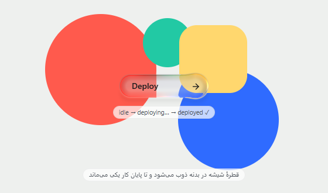

# دکمهٔ اقدام شیشه‌ای — Merge · GlassActionButton

دکمه‌ای برای یک کار ناهمگام (async)، که فلشش یک قطرهٔ شیشهٔ جداگانه است. با فشار دادن، قطره در بدنهٔ دکمه ذوب می‌شود و تا پایان کار — و بعد از موفقیت — یکی می‌ماند: در حالت `pending` به‌جای فلش یک اسپینر می‌چرخد، و در حالت `success` یک تیک خودش را می‌کشد، شیشه یک بار متورم می‌شود و متن با آن کش می‌آید. متنِ ساده حرف‌به‌حرف از دل تاری و بلور بیرون می‌آید؛ هر برچسب دیگری یک‌تکه بالا می‌آید.

اگر کار خطا بدهد، قطره دوباره جدا می‌شود و `onActionError` صدا زده می‌شود. با `resetAfter` (میلی‌ثانیه) قطره پس از موفقیت خودش جدا می‌شود؛ پیش‌فرض `0` یعنی یکی می‌ماند. با عوض کردن `resetKey` هم خودتان به حالت اول برمی‌گردانید: کامپوننت mount می‌ماند، پس قطره با فنر بیرون می‌آید و برچسب به‌جای پرش، مورف می‌شود.

## تصاویر

## فایل‌ها

- `demo.html` — پیش‌نمایش زندهٔ بدون build؛ کافی است در مرورگر بازش کنید.
- `card.png` — اسکرین‌شات همان پیش‌نمایش.
- `../src/liquid-glass/glass-action-button.tsx` — کامپوننت اصلی (`GlassActionButton`) که همین‌جا عیناً کپی شده است.
- `../src/liquid-glass/glass-layer.tsx` — `GlassLayer`، همان لایه‌ای که قطره (`droplet`) و تپش (`pulse`) و کشیدگی محتوا (`--glass-bend`) را می‌کشد.
- `../liquid-glass.js` — ران‌تایم وانیلا که `demo.html` بار می‌کند و از همان سورس بالا به‌صورت مکانیکی ساخته شده است.
- `../glass.css` — اسکلت مشترک دموها: قاب صحنه، فونت و قطعه‌های پس‌زمینه‌ای که شیشه خمشان می‌کند.

`demo.html` یک **بازآفرینی بدون build** از همان رندرکننده است: کدی که شیشه را می‌کشد بازنویسی نشده و از سورس بالایی برداشته شده (`engine.ts` و `dom-snapshot.ts` بدون تغییر، و بدنهٔ افکت `GlassLayer` همان‌طور که هست)؛ فقط React کنار گذاشته شده و جایش فراخوانی‌های سادهٔ DOM آمده است. چرخهٔ سه‌حالته، تایپ‌شدن حرف‌به‌حرف برچسب و همان CSS حروف (`glass-letter`) هم از خود کامپوننت آمده. دمو در اندازهٔ `md` اجرا می‌شود (ارتفاع ۴۰px، پدینگ چپ ۲۰px و راست ۳۶px) با `material: 'clear'` و `tint: 0.25`، و برای اینکه قابل تکرار باشد با `RESET_AFTER = 6000` خودش قطره را دوباره جدا می‌کند؛ کار ساختگی‌اش ۱۴۰۰ میلی‌ثانیه طول می‌کشد و برچسب‌ها `Deploy` → `Deploying` → `Deployed` هستند.

## منبع

- ریپو: <https://github.com/bilalgursen/liquid-glass>
- فایل در ریپو: `src/components/liquid-glass/glass-action-button.tsx`
- لایسنس: MIT
- تاریخ جمع‌آوری: ۲۴ نوامبر ۲۰۲۶

## پراپ‌ها

| پراپ | نوع | پیش‌فرض | توضیح |
| --- | --- | --- | --- |
| `children` | `ReactNode` | — (الزامی) | برچسب حالت عادی؛ نام دسترس‌پذیر دکمه هم همین است |
| `onAction` | `() => unknown` | — (الزامی) | با فشار اجرا می‌شود؛ اگر Promise برگرداند، تا تسویهٔ آن `pending` می‌ماند |
| `onActionError` | `(error: unknown) => void` | — | وقتی `onAction` خطا بدهد یا reject شود صدا زده می‌شود و دکمه به حالت اول برمی‌گردد |
| `pendingLabel` | `ReactNode` | همان `children` | برچسب در طول اجرای کار |
| `successLabel` | `ReactNode` | همان `children` | برچسب پس از موفقیت |
| `resetAfter` | `number` | `0` | چند میلی‌ثانیه بعد از موفقیت قطره دوباره جدا شود؛ `0` یعنی یکی می‌ماند |
| `resetKey` | `unknown` | — | با عوض شدنش دکمه به حالت اول برمی‌گردد و نتیجهٔ کار در جریان دور ریخته می‌شود |
| `icon` | `ReactNode` | یک فلش | آیکون حالت عادی قطره |
| `material` | `'clear' \| 'tinted'` | `'clear'` | شیشهٔ شفاف که پشت را خم می‌کند، یا شیشه به رنگ پس‌زمینهٔ خود دکمه |
| `size` | `'sm' \| 'md' \| 'lg'` | `'md'` | ارتفاع ۳۲، ۴۰ یا ۴۸ پیکسل؛ اندازهٔ قطره هم با آن می‌آید |
| `tint` | `number` | `0.6` (از `GlassLayer`) | در شیشهٔ شفاف، مقدار رنگی که روی پشت می‌نشیند (۰ تا ۱) |
| `className` | `string` | `''` | کلاس‌های خودتان (مثلاً رنگ شیشهٔ `tinted`) |
| `disabled` | `boolean` | `false` | دکمه غیرفعال شود |
| `type` | `'button' \| 'submit' \| 'reset'` | `'button'` | نوع HTML دکمه |

بقیهٔ اتریبیوت‌های `<button>` (مثل `aria-*` و `onPointerDown`) پاس داده می‌شوند؛ `children`، `className` و `onClick` را خود کامپوننت مدیریت می‌کند.

## نکات پیاده‌سازی

- قطره قانون خودش را دارد: افکت چسبناک کل کیت فقط در همین کامپوننت است، و قطره باید فرزند مستقیم همان میزبان باشد با نشانهٔ `data-glass-drop`. یعنی بدنه و قطره یک لایه و یک کانواس‌اند و پل میانشان را همان شیدر می‌کشد؛ پس برای بدنه و قطره دو شیشهٔ جدا نسازید و این دکمه را داخل گروه (`GlassButtonGroupItem`) هم نگذارید.
- حالت‌ها از یک Promise می‌آیند، نه از تایمر: تا `onAction` تسویه نشود دکمه `pending` است (`aria-busy` و `aria-disabled` می‌گیرد) و برچسب حالت در یک `role="status"` برای صفحه‌خوان اعلام می‌شود.
- موتور مشترک: کل کیت یک کانتکست <bdi>WebGL2</bdi> و یک شیدر دارد و نتیجهٔ هر سطح را در کانواس دوبعدی خودش می‌نویسد؛ رندرکننده هیچ وابستگی‌ای ندارد و حرکت فنری است (قطرهٔ جدا‌شونده و ذوب‌شونده دو فنر جدا دارند).
- اسنپ‌شات DOM: شیشه آنچه پشتش است را با پیمایش DOM دوباره نقاشی می‌کند، پس پس‌زمینه باید فقط رنگ تخت و عنصر واقعی باشد — گرادیان، ماسک CSS، فیلتر و شبه‌عنصر برایش دیده نمی‌شود. صحنهٔ دمو به همین دلیل از بلوک‌های `div` ساده ساخته شده است.
- تا اولین فریم شیشه، دکمه ظاهر CSS خودش را دارد و یک خط جداکننده کنار آیکون؛ بعد از آن میزبان `data-glass-ready` می‌گیرد، پس‌زمینه و حاشیه و سایهٔ CSS کنار می‌رود و خط جداکننده هم پنهان می‌شود چون خود شیشه قطره را می‌کشد. بدون <bdi>WebGL2</bdi> همان ظاهر CSS با خط جداکننده می‌ماند و چیزی نمی‌شکند.
- این کامپوننت دست‌نویس است و به UI SDK نیاز ندارد؛ با `prefers-reduced-motion` فنرها و انیمیشن حروف می‌ایستند ولی چرخهٔ حالت‌ها همان است.

