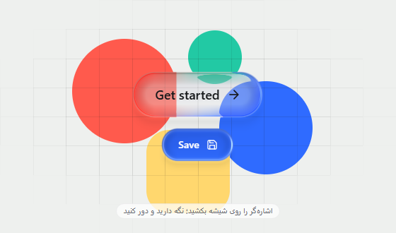

# دکمهٔ شیشه‌ای — Press · GlassButton

دکمه‌ای از جنس شیشهٔ مایع: خودِ شیشه را یک رندرکنندهٔ <bdi>WebGL2</bdi> می‌کشد و متن و آیکون روی آن می‌نشیند. با بردن اشاره‌گر روی دکمه، شیشه با فنرهای ناهمسان متورم می‌شود و مثل یک قطره موج برمی‌دارد؛ با فشردن، تا حدود ۸٪ بزرگ‌تر می‌شود. اگر دکمه را نگه دارید و اشاره‌گر را دور ببرید، شیشه تا یک جایی دنبال انگشت می‌آید، در جهت کشش دراز و نازک می‌شود و وقتی رها کنید مثل ژل به جای خودش برمی‌گردد — با `pull={false}` سر جایش می‌ماند.

دو حالت دارد: شیشهٔ شفاف (`clear`) که صفحهٔ پشت خود را خم می‌کند و لبه‌اش رنگ همسایه‌ها را بازمی‌تاباند، و شیشهٔ رنگ‌شده (`tinted`) که رنگش را از پس‌زمینهٔ CSS خود دکمه می‌گیرد؛ پس با یک کلاس معمولی مثل `bg-blue-500` رنگش می‌کنید.

## تصاویر

## فایل‌ها

- `demo.html` — پیش‌نمایش زندهٔ بدون build؛ کافی است در مرورگر بازش کنید.
- `card.png` — اسکرین‌شات همان پیش‌نمایش.
- `../src/liquid-glass/glass-button.tsx` — کامپوننت اصلی (`GlassButton`) که همین‌جا عیناً کپی شده است.
- `../src/liquid-glass/glass-layer.tsx` — `GlassLayer`، لایهٔ مشترکی که دکمه پراپ‌های شیشه‌اش (`material`، `tint`، `pull`) را به آن می‌سپارد.
- `../liquid-glass.js` — ران‌تایم وانیلا که `demo.html` بار می‌کند و از همان سورس بالا به‌صورت مکانیکی ساخته شده است.
- `../glass.css` — اسکلت مشترک دموها: قاب صحنه، فونت، و قطعه‌های پس‌زمینه‌ای که شیشه خمشان می‌کند.

`demo.html` یک **بازآفرینی بدون build** از همان رندرکننده است: کدی که شیشه را می‌کشد بازنویسی نشده و همان‌طور که هست از سورس بالایی برداشته شده (`engine.ts` و `dom-snapshot.ts` بدون تغییر، و بدنهٔ افکت `GlassLayer` همان‌طور که هست)؛ تنها React کنار گذاشته شده و جایش فراخوانی‌های سادهٔ DOM آمده است. در دمو دو نمونه هست: شیشهٔ شفاف با `tint: 0.32` و ارتفاع ۶۴px و پدینگ افقی ۳۰px و متن ۱۸px، و یک نمونهٔ `tinted` روی رنگ خودش `#2f6bff` با `tint: 0.85` و ارتفاع ۴۶px.

## منبع

- ریپو: <https://github.com/bilalgursen/liquid-glass>
- فایل در ریپو: `src/components/liquid-glass/glass-button.tsx`
- لایسنس: MIT
- تاریخ جمع‌آوری: ۲۴ نوامبر ۲۰۲۶

## پراپ‌ها

| پراپ | نوع | پیش‌فرض | توضیح |
| --- | --- | --- | --- |
| `children` | `ReactNode` | — | متن یا محتوای دکمه |
| `material` | `'clear' \| 'tinted'` | `'clear'` | شیشهٔ شفاف که پشت را خم می‌کند، یا شیشه به رنگ پس‌زمینهٔ خود دکمه |
| `size` | `'sm' \| 'md' \| 'lg' \| 'xl'` | `'md'` | ارتفاع و پدینگ و اندازهٔ متن: ۳۲، ۴۰، ۴۸ و ۶۴ پیکسل |
| `icon` | `ReactNode` | — | یک آیکون (مثلاً از `lucide-react`) |
| `iconPosition` | `'start' \| 'end'` | `'end'` | آیکون پیش از متن یا پس از آن |
| `tint` | `number` | `0.6` (از `GlassLayer`) | در شیشهٔ شفاف، مقدار رنگی که روی پشت می‌نشیند (۰ تا ۱) |
| `pull` | `boolean` | `true` | نگه‌داشتن و کشیدن: دکمه کمی دنبال اشاره‌گر می‌آید و در جهت کشش دراز می‌شود |
| `asChild` | `boolean` | `false` | شیشه روی همان فرزند (مثلاً یک `<Link>` روتر) می‌نشیند، نه روی یک `<button>` |
| `className` | `string` | `''` | کلاس‌های خودتان؛ هر کلاس `rounded-*` گوشه‌های قرص‌شکل را عوض می‌کند |
| `type` | `string` | `'button'` | نوع HTML دکمه |

بقیهٔ پراپ‌های دکمهٔ پایه (مثل `onClick`، `disabled` و `aria-*`) بی‌واسطه پاس داده می‌شوند؛ فقط `children`، `className` و `render` کنار گذاشته شده‌اند.

## نکات پیاده‌سازی

- موتور مشترک: کل کیت یک کانتکست <bdi>WebGL2</bdi> و یک شیدر دارد و نتیجهٔ هر سطح را در کانواس دوبعدی خودش می‌نویسد، پس چند شیشه روی یک صفحه به سقف کانتکست مرورگر نمی‌خورند. رندرکننده هیچ وابستگی‌ای ندارد و حرکت با فنر است؛ فنرهای `hoverX` و `hoverY` عمداً ناهم‌فازند تا شیشه موج بردارد.
- اسنپ‌شات DOM: شیشه آنچه پشتش است را با پیمایش DOM دوباره نقاشی می‌کند، پس پس‌زمینه باید فقط رنگ تخت و عنصر واقعی باشد — گرادیان، ماسک CSS، فیلتر و شبه‌عنصر برایش دیده نمی‌شود. به همین دلیل صحنهٔ دمو از بلوک‌های `div` ساده (`#ff5a4d`، `#2f6bff`، `#22c9a4` و پنل `#ffd76e`) و یک شبکهٔ خط‌مویی از عناصر واقعی `<i>` ساخته شده است.
- تا اولین فریم شیشه، دکمه ظاهر CSS خودش را دارد (پس‌زمینهٔ سفید نیمه‌شفاف، حاشیه و سایهٔ ملایم). وقتی شیشه کشیده شد، میزبان `data-glass-ready` می‌گیرد و همان پس‌زمینه و حاشیه و سایهٔ CSS را کنار می‌گذارد تا دوباره روی شیشه نیفتد؛ در شیشهٔ شفاف هم `data-glass-tone` روشن یا تیره بودن شیشه را اعلام می‌کند و متن دکمه با آن خوانا می‌شود.
- بدون <bdi>WebGL2</bdi> هیچ‌چیز نمی‌شکند: همان ظاهر CSS می‌ماند و دکمه مثل یک دکمهٔ معمولی کار می‌کند.
- با `prefers-reduced-motion` فنرها همان اول در حالت سکون می‌نشینند و هیچ تکان و کششی اجرا نمی‌شود؛ شیشه اما همچنان کشیده می‌شود.
- این کامپوننت رفتارش را از UI SDK می‌گیرد: به `@ui-sdk/core` و `@ui-sdk/react` نیاز دارد (دکمه از `@ui-sdk/react/button` می‌آید و کیبورد، فوکوس و ARIA کار آن است). اگر از `onClick` یک Promise برگردانید، دکمه تا تسویهٔ آن در حالت انتظار می‌ماند و فشار دوم را نمی‌پذیرد.

