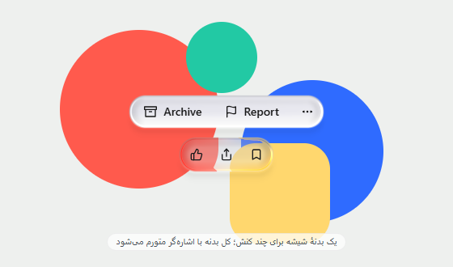

# گروه دکمهٔ شیشه‌ای — Share · GlassButtonGroup

چند کنش مرتبط در یک بدنهٔ واحد شیشه: دکمه‌ها همه در یک شیشه می‌نشینند و یک عدسی مشترک دارند. با بردن اشاره‌گر روی هر کدام از دکمه‌ها، کل بدنه متورم می‌شود و با فشردن، بزرگ‌تر می‌شود. خود دکمه‌های داخل گروه شیشهٔ جداگانه‌ای ندارند؛ پس نباید یک `GlassButton` را داخل گروه گذاشت. گروه را می‌شود عمودی هم چید و گروه‌ها را در هم تودرتو کرد تا چند کنش نزدیک به هم و چند کنش جدا از هم بمانند.

## تصاویر

## فایل‌ها

- `demo.html` — پیش‌نمایش زندهٔ بدون build؛ کافی است در مرورگر بازش کنید.
- `card.png` — اسکرین‌شات همان پیش‌نمایش.
- `../src/liquid-glass/glass-button-group.tsx` — کامپوننت اصلی (`GlassButtonGroup` با اجزای `GlassButtonGroupItem`، `GlassButtonGroupSeparator` و `GlassButtonGroupText`) که همین‌جا عیناً کپی شده است.
- `../src/liquid-glass/glass-layer.tsx` — `GlassLayer`، همان لایه‌ای که یک بدنهٔ شیشه برای کل گروه می‌کشد.
- `../liquid-glass.js` — ران‌تایم وانیلا که `demo.html` بار می‌کند و از همان سورس بالا به‌صورت مکانیکی ساخته شده است.
- `../glass.css` — اسکلت مشترک دموها: قاب صحنه، فونت و قطعه‌های پس‌زمینه‌ای که شیشه خمشان می‌کند.

`demo.html` یک **بازآفرینی بدون build** از همان رندرکننده است: کدی که شیشه را می‌کشد بازنویسی نشده و از سورس بالایی برداشته شده (`engine.ts` و `dom-snapshot.ts` بدون تغییر، و بدنهٔ افکت `GlassLayer` همان‌طور که هست)؛ فقط React کنار گذاشته شده و جایش فراخوانی‌های سادهٔ DOM آمده است. دمو دو گروه دارد، هر دو در اندازهٔ `md`: یکی `tinted` (پیش‌فرض) با `tint: 0.85` روی بدنهٔ سفید و دکمه‌های Archive و Report و یک جداکننده و دکمهٔ آیکونی More، و یکی `clear` با `tint: 0.3` که پشت را خم می‌کند و سه دکمهٔ آیکونی دارد.

## منبع

- ریپو: <https://github.com/bilalgursen/liquid-glass>
- فایل در ریپو: `src/components/liquid-glass/glass-button-group.tsx`
- لایسنس: MIT
- تاریخ جمع‌آوری: ۲۴ نوامبر ۲۰۲۶

## پراپ‌ها

| پراپ | نوع | پیش‌فرض | توضیح |
| --- | --- | --- | --- |
| `children` | `ReactNode` | — | دکمه‌ها، جداکننده‌ها و متن‌های گروه |
| `orientation` | `'horizontal' \| 'vertical'` | `'horizontal'` | کنار هم یا روی هم |
| `size` | `'sm' \| 'md' \| 'lg'` | `'md'` | ارتفاع گروه افقی: ۳۲، ۴۰ یا ۴۸ پیکسل؛ دکمه‌ها هم با آن می‌آیند |
| `material` | `'clear' \| 'tinted'` | `'tinted'` | `tinted` سفید است، یا رنگ کلاس `bg-*` خودتان؛ `clear` پشت را خم می‌کند |
| `tint` | `number` | `0.6` (از `GlassLayer`) | در شیشهٔ شفاف، مقدار رنگی که روی پشت می‌نشیند (۰ تا ۱) |
| `className` | `string` | `''` | کلاس‌های خودتان؛ هر کلاس `rounded-*` گوشه‌ها را عوض می‌کند |

و پراپ‌های `GlassButtonGroupItem`، یعنی همان دکمه‌های داخل گروه:

| پراپ | نوع | پیش‌فرض | توضیح |
| --- | --- | --- | --- |
| `children` | `ReactNode` | — | متن یا آیکون دکمه |
| `asChild` | `boolean` | `false` | دکمه روی همان فرزند (مثلاً یک `<Link>`) رندر شود، نه روی `<button>` |
| `className` | `string` | `''` | کلاس‌های خودتان |
| `type` | `'button' \| 'submit' \| 'reset'` | `'button'` | نوع HTML دکمه |

`GlassButtonGroupSeparator` فقط `className` می‌گیرد (خط مویی میان دو دکمه است و با گروه می‌چرخد)، و `GlassButtonGroupText` هم `children` و `className` (متنی که دکمه نیست: یک واحد، یک عدد، یا برچسب دکمه‌های کنارش). بقیهٔ اتریبیوت‌های `
` و `<button>` پاس داده می‌شوند.

## نکات پیاده‌سازی

- یک بدنه، یک عدسی: لایهٔ شیشه تنها فرزند اول گروه است و دکمه‌ها هیچ شیشه و هیچ پرکردنی از خودشان ندارند، پس تورم و بزرگ‌شدن به کل بدنه جواب می‌دهد نه به یک دکمه. تودرتو کردن گروه‌ها فقط فاصله می‌اندازد (`gap-2`) و هر گروه داخلی بدنهٔ شیشهٔ خودش را می‌گیرد.
- موتور مشترک: کل کیت یک کانتکست <bdi>WebGL2</bdi> و یک شیدر دارد و نتیجهٔ هر سطح را در کانواس دوبعدی خودش می‌نویسد؛ رندرکننده هیچ وابستگی‌ای ندارد و حرکت با فنر است. در چیدمان عمودی، سایهٔ شیشه که با ارتفاع بدنه بزرگ می‌شود، با `shadowOffset` و `shadowSoftness` برابر ۰٫۳۵ به اندازهٔ یک دکمه برگردانده می‌شود، و گوشه‌ها هم از قرص به گوشهٔ گردِ متناسب با همان اندازه می‌رسند.
- اسنپ‌شات DOM: شیشه آنچه پشتش است را با پیمایش DOM دوباره نقاشی می‌کند، پس پس‌زمینه باید فقط رنگ تخت و عنصر واقعی باشد — گرادیان، ماسک CSS، فیلتر و شبه‌عنصر برایش دیده نمی‌شود. صحنهٔ دمو به همین دلیل از بلوک‌های `div` ساده ساخته شده است.
- تا اولین فریم شیشه، گروه ظاهر CSS خودش را دارد؛ بعد از آن میزبان `data-glass-ready` می‌گیرد و پس‌زمینه و حاشیه و سایهٔ CSS کنار می‌رود. در شیشهٔ شفاف `data-glass-tone` هم روشن یا تیره بودن شیشه را اعلام می‌کند تا متن با آن خوانا شود. بدون <bdi>WebGL2</bdi> همان ظاهر CSS می‌ماند و چیزی نمی‌شکند.
- با `prefers-reduced-motion` فنرها در سکون می‌نشینند: شیشه کشیده می‌شود ولی تورم و کشش اجرا نمی‌شود.
- این کامپوننت دست‌نویس است و به UI SDK نیاز ندارد.

