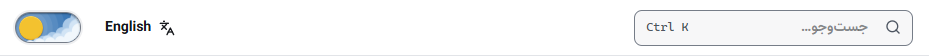
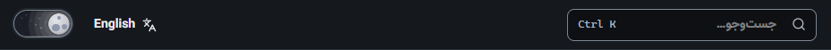

# سوییچ شب و روز — VibeHub

کلید تعویض تمِ اپ VibeHub: یک صحنهٔ کوچک شبانه‌روزی داخل یک کپسول — خورشید، ماه با دهانه، ابرهای سه‌لایه که شب فرو می‌روند، ستاره‌های چشمک‌زن و شهاب‌سنگِ دوره‌ای. کلیک روی آن با یک انیمیشن فشردگی فنری، حالت تم را عوض می‌کند.

## تصاویر

| روز | شب |
| --- | --- |
|  |  |

نمای واقعی داخل تایتل‌بار اپ:

| روز (تایتل‌بار) | شب (تایتل‌بار) |
| --- | --- |
|  |  |

## فایل‌ها

- `ThemeToggle.tsx` — کامپوننت React (دقیقاً همان نسخهٔ VibeHub)
- `day-night.css` — استایل‌های کامل صحنه (اسکوپ‌شده زیر `.vh-daynight`)
- `demo.html` — دموی زندهٔ بدون ابزار-build؛ همان DOM که اپ واقعی رندر می‌کند، با دو نمونهٔ ثابت (روز/شب) و یک نمونهٔ زنده که با کلیک کار می‌کند. کافی است در مرورگر بازش کنید.
- `shots/` — اسکرین‌شات‌های واقعی از اپ در حال اجرا

## منبع اصلی در VibeHub

- کامپوننت: `apps/desktop/src/components/ThemeToggle.tsx`
- استایل: `apps/desktop/src/styles/day-night.css`

## نکات پیاده‌سازی

- بازآفرینی React از [interactive-day-night-toggle](https://github.com/HamzehGhoreyshi/interactive-day-night-toggle) اثر حمزه قریشی (لایسنس MIT) — همهٔ کلاس‌ها زیر `.vh-daynight` اسکوپ شده‌اند تا با استایل‌های اپ تداخل نکنند.
- ابعاد فقط با یک متغیر `--vh-dn-size` کنترل می‌شود؛ همهٔ هندسهٔ داخلی با واحدهای container-query است، پس هر اندازه‌ای نسبت 530×243 خودش را حفظ می‌کند.
- سه منحنی حرکتی سفارشی (`linear()` فنری نرم و جهشی) به‌جای easing ساده.
- برای `prefers-reduced-motion` صحنه بی‌صدا می‌شود ولی تغییر حالت حفظ می‌شود.

